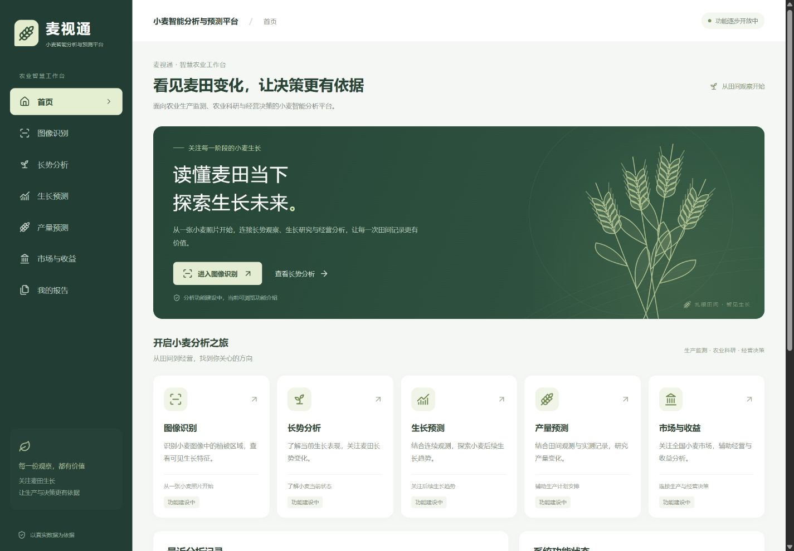

# 麦视通——小麦智能分析与预测平台

面向农业生产监测、农业科研和经营决策的 Vue 3 前端。当前提供统一导航、功能介绍与建设状态，不执行识别或预测业务。

## 启动与构建

```powershell
cd D:\Desktop\wheat\source-code\wheat-phenotyping\frontend
npm.cmd run dev
```

打开 **http://127.0.0.1:5173/**。依赖已安装；新环境可用 `npm.cmd ci` 按锁文件安装。停止服务器按 Ctrl+C。

```powershell
npm.cmd run build
npm.cmd run preview
```

构建产物位于 `dist/`，预览地址为 **http://127.0.0.1:4173/**。默认只监听本机。端口占用时可用 `npm.cmd run dev -- --port 5174` 并访问对应端口。

## 页面

| 主导航 | 地址 |
| --- | --- |
| 首页 | /#/ |
| 图像识别 | /#/image-recognition |
| 长势分析 | /#/growth-analysis |
| 生长预测 | /#/growth-prediction |
| 产量预测 | /#/yield-prediction |
| 市场与收益 | /#/market-returns |
| 我的报告 | /#/reports |

原有 `/#/phenotype-analysis`、`/#/research-center`、`/#/prediction` 仍可访问，首页底部保留入口。路由采用哈希模式。

## 本轮 UI 文件变更

| 文件 | 作用 |
| --- | --- |
| src/App.vue | 麦视通标识、深绿侧栏、七项导航、统一顶部与页脚 |
| src/styles.css | 全站颜色、文字、宽度、间距、卡片与自适应规范 |
| src/views/Home.vue | 产品介绍、五个业务入口、最近记录空状态与功能状态 |
| src/components/ModulePage.vue | 六个业务页及保留页面共用的布局与建设状态 |
| src/config/modules.js | 中文导航、业务说明、提示与页面状态 |
| src/router/index.js | 显式路由映射与麦视通页面标题，保留旧地址 |
| index.html | 产品标题与简介 |
| README.md | 启动方式、页面与验收说明 |
| src/views/GrowthPrediction.vue | 新增生长预测展示入口 |
| src/views/YieldPrediction.vue | 新增产量预测展示入口 |
| src/views/MarketReturns.vue | 新增市场与收益展示入口 |
| docs/maishitong-home.jpg | 浏览器实拍首页预览 |

未变更依赖声明或锁文件。原有六个页面入口文件仍保留，复用公共状态页。

## 本轮验收记录（2026-11-13）

- `npm.cmd run build` 成功，产出全部主页面与保留页面。
- 浏览器逐一打开七个主页面，页面标题与导航高亮正确。
- 首页五个功能卡片均跳转到对应页面。
- 首页底部三个旧页面入口均打开对应原地址。
- 1366 × 900 与 1920 × 900 下检查七页，无横向溢出，各页标题区位置一致。
- 390 × 844 下菜单可展开，切换到首页自动收起，无横向溢出。
- 图像上传按钮为禁用状态，不接收图片；最近记录显示真实空状态。
- 浏览器检查结束时读取到的 warning/error 日志为空。

仅优化前端界面，没有新增识别、预测或经济业务。所有未开放功能显示“功能建设中”，不展示虚构分析结果。




## 最新首页品质升级

本轮只更新首页与共享布局，保留原路由和其他六个业务页。完整改动清单、真实验收记录、素材来源及生成提示词见 [首页升级说明](docs/premium-home-upgrade.md)。

## 最新参考图风格改版

当前界面采用浅色画布、顶部胶囊导航、麦田主画面与右侧信息卡片。详见 [参考图风格改版说明与验收](docs/reference-dashboard-redesign.md)。

## 当前视觉：小麦植物档案

当前统一采用森林绿、麦穗金与米白纸感，保留七个页面及路由，首页使用原创小麦图版，并在首页、图像识别、长势分析中预留三维展示区域。见 [视觉修正与验收说明](docs/botanical-direction-update.md)。

## 当前主题：欧式古典小麦油画

在植物档案版式上增加麦田油画、古金画框、卷叶角饰与纹样底纸，继续保留七个页面和所有真实状态说明。见 [古典油画主题说明、素材来源与验收](docs/classical-oil-theme.md)。

## P1 / P2 页面风格分层

首页采用品牌展示风格，六个功能页采用可视化工作台。修改文件、页面对照和验收结果见 [页面风格分层说明](docs/p1-p2-layering.md)。
