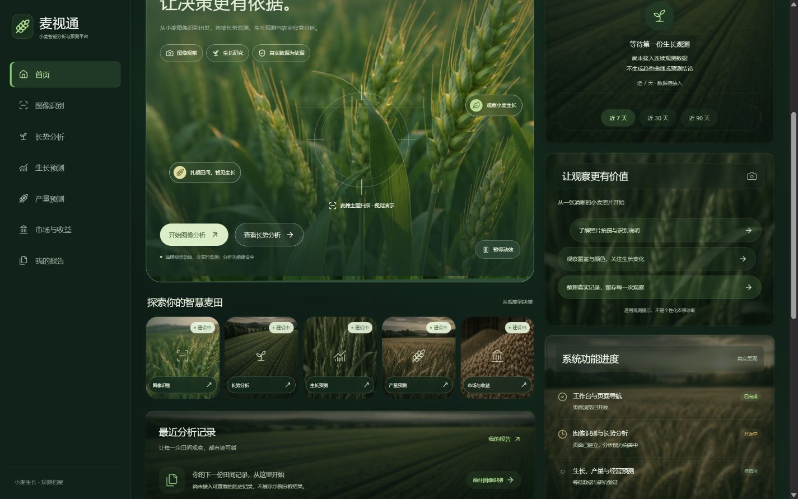
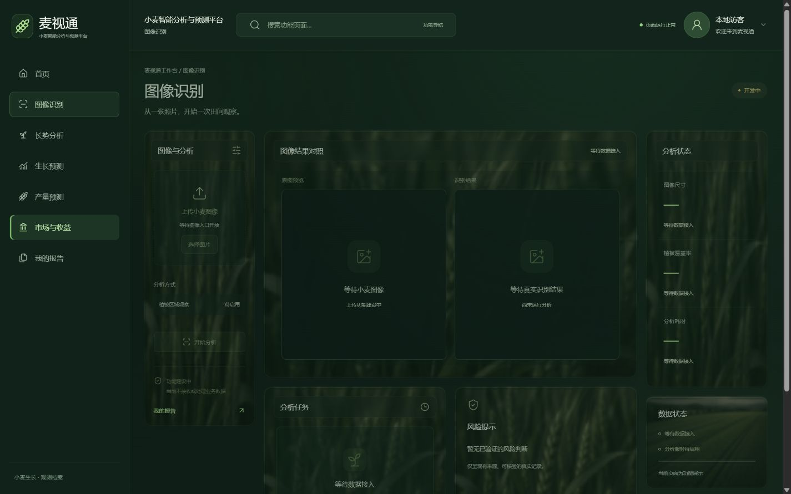
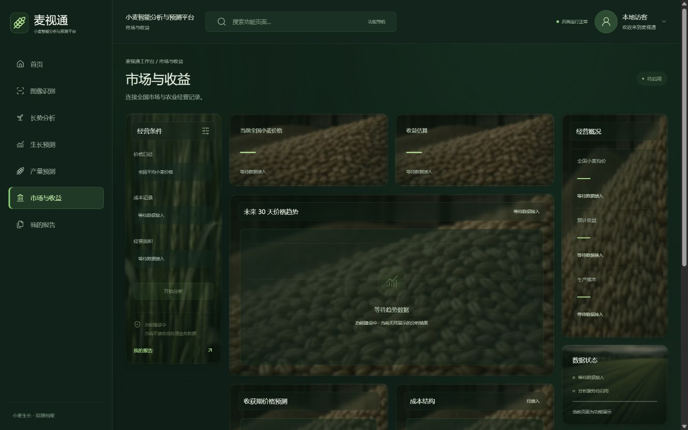

# 农业场景图片背景面板升级

## 文件变更

- 新增 src/assets/agriculture-atmosphere.png：统一摄影质感的四场景品牌素材图集。
- 新增 src/styles/agriculture-scenes.css：面板图像、虚化、暗化、玻璃内容的分层实现与场景分配。
- 修改 src/main.js：引入新的共享主题。
- 修改 src/components/WorkspacePage.vue：增加 data-scene 展示属性，用于六个页面的 CSS 场景选择，不改变业务逻辑。
- 新增 docs/scene-home.jpg、scene-image.jpg、scene-market.jpg：实际浏览器预览。

## 视觉分配与真实性

图集四区：绿田高视角、麦穗近景、成熟麦田、仓储麦粒。首页功能卡片及右侧观测、提示、进度、生育阶段、记录、市场模块分别选景。二级工作台的操作、主图表、指标、风险和报告面板均使用相关图片。

各主要面板通过 ::before 显示独立图片层，使用 blur(2px)、brightness(0.86)、saturate(0.72)；::after 使用深绿半透明遮罩；上层标题与内容保留半透明玻璃底。背景层不拦截点击，不虚化正文。

原图、识别结果的预览槽仍是较高不透明度的空状态，不将装饰图伪装成上传图片或预测结果。首页原麦田主视觉与动效保持不变。

没有修改路由、Python、数据、实验结果、上传逻辑或新增业务功能。原上传按钮仍为禁用状态。

## 实际检查

- 初次 npm.cmd run build 成功，退出码 0。
- 七页逐一检查：54 个主要面板均具有 agriculture-atmosphere 图像背景层；各页无横向溢出。
- 浏览器计算样式确认图片 URL、2px 虚化、亮度/饱和度处理和独立暗色遮罩。
- 查看首页、图像识别、市场与收益的实际画面，图片和玻璃内容分层正常。
- 1920×1080、1366×768、390×844 额外检查首页/图像识别/市场页，无横向溢出；1440×900 下逐页检查正常。
- 麦田动效暂停状态为 paused，继续播放正常。
- 最终浏览器 warning/error 日志为空。

## 素材来源

使用内置 image_gen 工具生成，非 CLI。新素材为 AI 生成的品牌装饰图片，不是真实采样或科研验证数据，不应导入实验数据集。最终项目路径：frontend/src/assets/agriculture-atmosphere.png。

最终提示词：

> Create ONE high quality photographic background atlas for a premium dark green agricultural AI dashboard. A perfectly aligned 2x2 grid with exactly four equally sized rectangular photographs, no gutters or borders. Upper left: high-angle drone view of lush green wheat farmland with elegant parallel crop rows. Upper right: close-up of healthy green wheat spikes and leaves in soft focus. Lower left: mature golden-green wheat field approaching harvest in late afternoon, restrained warm gold, no machinery. Lower right: detailed pile of harvested wheat kernels in a grain storage setting, no text, no packaging. All four quadrants share a coherent premium natural editorial photographic style, muted forest green and olive color grading with subtle warm wheat gold, soft low-key light, rich details, no neon, no cartoon, no infographic, no words, no numbers, no UI, no watermark, no logos. Each quadrant fills its exact quarter of the image. Decorative atmosphere imagery only, not scientific evidence.

## 查看

在 frontend 目录运行 npm.cmd run dev，访问 http://127.0.0.1:5173/#/ ，切换图像识别或市场与收益查看面板。

