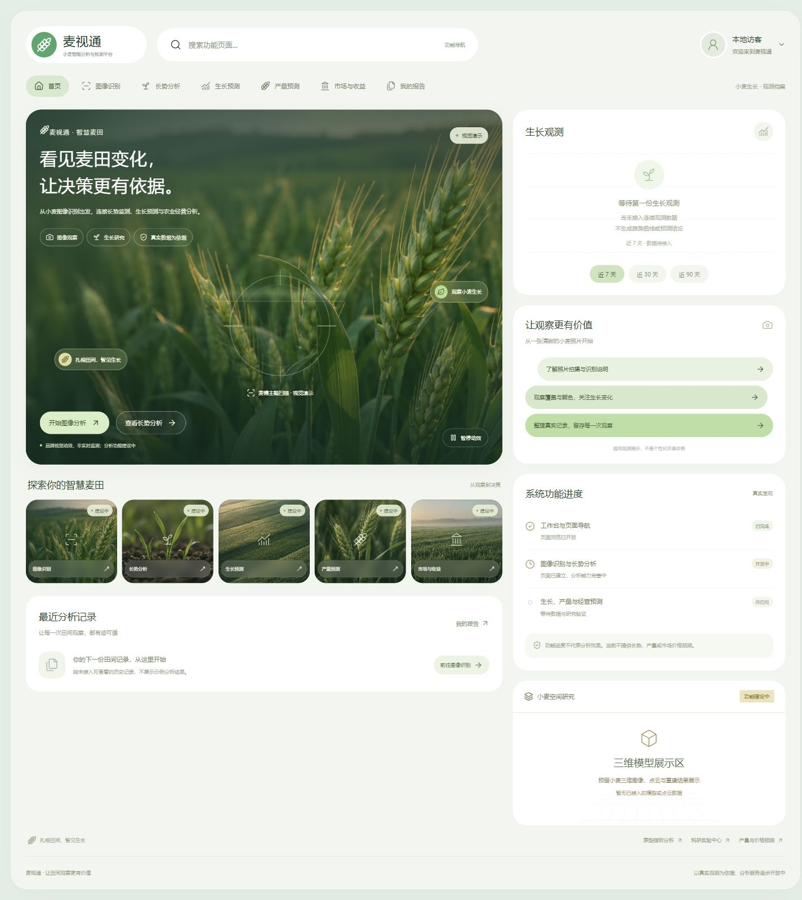

# 动态麦田首页改动与验收

本轮参考用户提供的农业工作台图片，使用大幅麦田观察区、圆角白卡、胶囊导航与右侧信息栏。未复制参考图中的业务数值、图表或建议。

## 文件

- src/views/Home.vue：用麦田动态主视觉替换油画展示，增加暂停/播放按钮。原图片功能入口、生长观测空状态、最近记录、三维展示预留区均保留。
- src/App.vue：将共享外壳的油画主题类改为 reference-theme，保留搜索和七项导航。
- src/main.js：加载新样式。
- src/styles/field-motion.css：浅色工作台外观，图片轻摇与缓慢缩放、扫描光带、呼吸观察框、浮动标签，以及暂停和减少动态效果规则。
- docs/animated-field-dashboard.jpg：实际浏览器全页预览。

没有改动路由、Python、数据或实验结果。已有油画素材与装饰组件保留在项目中。

## 动效说明

使用现有品牌图片配合 CSS 循环动画，是图片视觉动效，不是实拍视频或实时扫描。整个照片层轻微平移、旋转和缩放，观察框呼吸、扫描光带移动、标签浮动。所有标签仅表达品牌与功能含义，不显示假读数。

右下角按钮可暂停/播放全部四类动效。系统开启“减少动态效果”时默认暂停并使用静态视觉；本轮未修改操作系统设置。

## 实际检查

- npm.cmd run build：成功，退出码 0，2.40 秒。
- 浏览器动画样式显示 wheat-breeze 正在运行。
- 暂停后图片、观察框、扫描光带、两个标签的 animationPlayState 均为 paused；继续后为 running。
- 1920×1080、1440×900、1366×768、390×844：均无横向溢出。
- 七个导航链接均可切换，当前导航 aria-current 为 page。
- 开始图像分析与查看长势分析两个入口均跳转正确。
- 最终浏览器 warning/error 日志为空。

## 运行

在 frontend 目录执行 npm.cmd run dev，访问 http://127.0.0.1:5173/#/ 。右下角使用“暂停动效 / 播放动效”。

