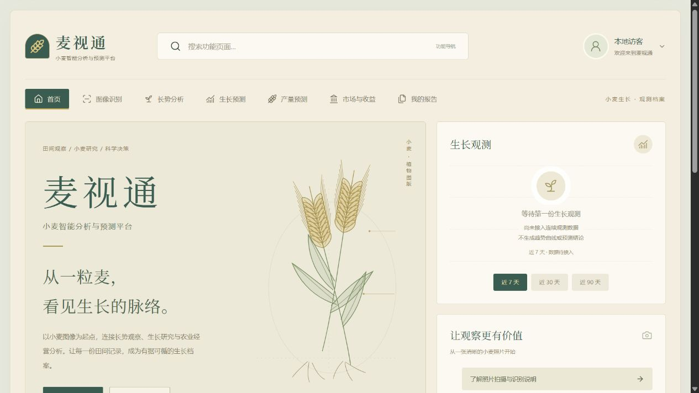

# 麦视通 · 小麦植物档案视觉修正

日期：2026-11-13。

## 现状检查与方向

修改前为麦田摄影、浅灰画布与胶囊导航的农业仪表盘。未发现人物肖像或黑红主视觉。本轮保留现有路由和页面骨架，将共享视觉调整为小麦植物图鉴、研究档案与农业科技结合的方向。

森林绿 #2F5D50、植株绿 #6F8A57、麦穗金 #D4B04C、米白 #F4EEDF、暖棕 #6C5A46 作为统一主题变量。使用细边框、克制的纸感纹理、中文衬线标题及麦穗线描，普通说明继续使用清晰的无衬线字体。

## 修改文件

| 文件 | 变更 |
| --- | --- |
| src/App.vue | 增加主题作用域，更新工作台副标识 |
| src/main.js | 加载共享植物档案主题样式 |
| src/views/Home.vue | 麦视通品牌标题、小麦插画与入口；保留双栏、功能卡片和状态模块；增加三维预留 |
| src/components/ModulePage.vue | 复用公共页面结构，按原路由呈现不同小麦研究展示区域 |
| README.md | 增加最新说明入口 |
| src/styles/botanical.css（新增） | 全站绿金米白色、档案版式、纸感背景和自适应规则 |
| src/components/WheatPlate.vue（新增） | 原创 SVG 植物学风格小麦装饰图版 |
| src/components/ModelPlaceholder.vue（新增） | 可复用三维模型/点云展示预留容器 |
| docs/botanical-home.jpg | 首页全页预览 |
| docs/botanical-image.jpg | 图像识别页全页预览 |
| docs/botanical-reports.jpg | 报告页全页预览 |
| docs/botanical-preview.jpg | 首页首屏预览 |
| docs/botanical-direction-update.md | 本说明 |

路由文件 SHA256 与修改前一致，七个页面及旧辅助页面均保留。没有修改 Python、数据集或实验结果。原有摄影装饰素材继续复用，新增线描为原创代码图形，并非真实样本。

## 七页展示

- 首页：突出“麦视通 / 小麦智能分析与预测平台”，配植物图版、绿金入口和三维预留。
- 图像识别：小麦原图与识别结果并排留位，保留建设中的上传区域，不接收图像或显示假掩膜。
- 长势分析：当前长势、植株与麦穗状态、生育阶段卡片均标为待观测。
- 生长预测：展示连续观测、环境记录、趋势研究、结果核验流程，明确不是实际生育阶段或预测结果。
- 产量预测：产量与实测参考卡片、空趋势区及预测限制说明。
- 市场与收益：全国小麦均价、成本、收益卡片及空趋势区，不填写价格和收益数值。
- 我的报告：研究档案式展示，明确尚未接入或生成真实报告。

## 三维展示边界

首页、图像识别、长势分析均存在“功能建设中 / 三维模型展示区”。立方体图标和底部网格仅装饰容器，未接入模型、点云或三维重建，也没有伪造三维分析结果。

## 实际验收

- npm.cmd run build 成功，退出码 0，Vite 构建用时 2.37 秒。
- 七页在 1920×1080、1440×900、1366×768、390×844 下逐一检查，均无横向溢出，当前导航高亮正确。
- 首页两个主入口、五个图片入口跳转正确，页面搜索“报告”可进入我的报告。
- 首页、图像识别、长势分析三维区域均实际加载。
- 通过完整页面截图检查首页、图像识别与报告页的版面。
- 最终完整刷新后，检查时间范围内没有新增控制台 warning/error。
- 本地预览服务器此前已停止，本轮重新启动并确认 5173 端口可访问。

## 查看方式

```powershell
cd D:\Desktop\wheat\source-code\wheat-phenotyping\frontend
npm.cmd run dev
```

访问 http://127.0.0.1:5173/#/ 。服务器已运行时刷新即可。

这轮完成的是视觉与展示预留。识别、长势和预测服务未在本轮实现；图版、占位和流程规划均不能用作科研实验结果。



