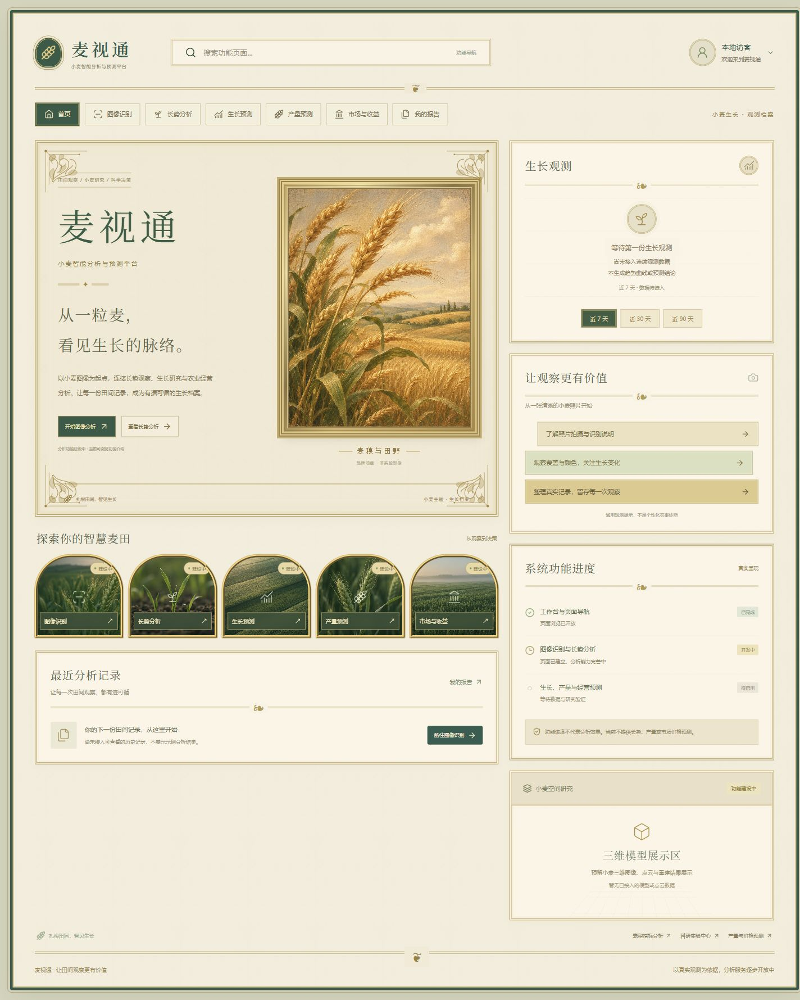

# 麦视通 · 欧式古典小麦油画主题

日期：2026-11-13。

本轮在植物档案主题基础上增加更丰富的欧式古典装饰。小麦仍是唯一主要视觉对象，保留绿色、麦穗金与米白色，不引入人物肖像、黑红主色或虚构业务结果。

## 修改与新增

- src/App.vue：启用油画主题作用域。
- src/main.js：加载古典油画主题样式。
- src/views/Home.vue：使用独立的小麦油画及金色画框，加入四角卷叶装饰；入口和页面结构保留。
- src/styles/classical-oil.css（新增）：古金多层画框、双线边框、纹样底纸、徽章标识、衬线标题、花叶分隔及响应式规则。
- src/components/OrnamentalFrame.vue（新增）：原创 SVG 卷叶角饰，禁用指针事件，避免遮挡入口。
- src/assets/wheat-damask.svg（新增）：原创麦穗卷叶重复底纹。
- src/assets/wheat-classical-oil.png（新增）：内置 image_gen 生成的装饰油画，使用非 CLI 模式。
- docs/classical-oil-preview.jpg（新增）：实际浏览器全页截图。
- README.md：增加当前主题说明链接。
- docs/classical-oil-theme.md：本说明。

原有线描组件与素材继续保留。没有修改路由、Python 算法、数据集、实验成绩或识别/预测业务。

## 验收

- npm.cmd run build 成功，退出码 0，构建耗时 1.93 秒。
- 首页在 1920×1080、1440×900、1366×768、390×844 下均无横向溢出，油画成功加载。
- 七个导航在 1440×900 下逐一检查，当前页面高亮正确，均无横向溢出。
- “开始图像分析”“查看长势分析”点击成功；搜索“报告”可进入我的报告。
- 最终完整刷新后，本轮验收时间范围内没有新增控制台 warning/error。
- 既有三维预留继续保留，未接入或伪造模型与点云。

## 素材声明与提示词

油画只用于品牌装饰，不是田间采样、实验图像或识别结果。文件保存于 frontend/src/assets/wheat-classical-oil.png；原生成文件也保留。边框、角花和底纹为本轮原创代码图形。

内置 image_gen 最终提示词：

> Create an original European classical oil painting on aged linen canvas for a premium wheat-themed agriculture platform. Portrait composition 4:5. The sole subject is WHEAT: a lavish painterly cluster of tall golden wheat ears and elegant green wheat leaves in the foreground, with rolling cultivated wheat fields, a small distant line of cypress-like trees and a pale luminous warm sky in the background. Evoke refined 18th to 19th century European botanical still life combined with a pastoral landscape: layered translucent glazes, visible rich brushwork, fine craquelure, tactile linen, exquisite natural detail, restrained chiaroscuro but overall luminous and readable. Forest green #2F5D50, olive #6F8A57, wheat gold #D4B04C, parchment ivory #F4EEDF, warm umber #6C5A46. Gracefully curved stems, golden awns catching soft afternoon light, old-world scholarly botanical mood. This is decorative brand art, NOT a specimen or scientific result. No people, no portraits, no statues, no faces, no museum interiors, no buildings, no red or black dominant palette, no text, no lettering, no watermark, no frame (frame will be made in webpage code). Fill the entire portrait canvas with the painting.

## 查看

开发服务器运行中可刷新 http://127.0.0.1:5173/#/ 。

重新启动：

```powershell
cd D:\Desktop\wheat\source-code\wheat-phenotyping\frontend
npm.cmd run dev
```



