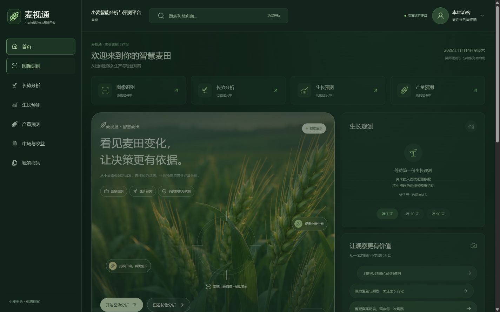
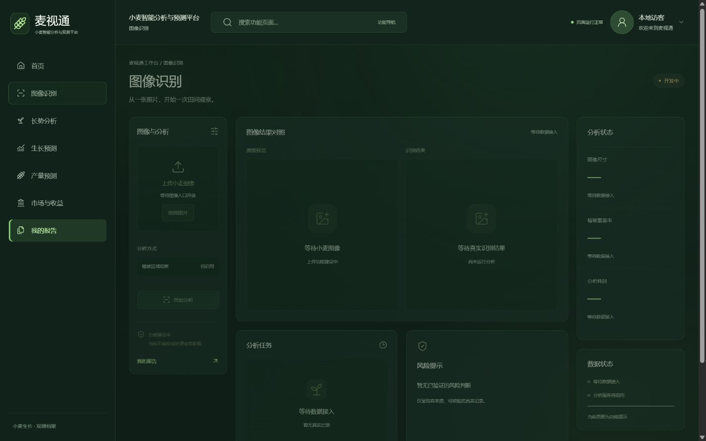

# 深色农业科技驾驶舱重构

## 改动

- src/App.vue：固定左侧七项导航、独立品牌标识、顶部系统名称与搜索、状态和用户区域。
- src/views/Home.vue：增加欢迎/日期、四个分析入口、生长阶段待接入区和市场入口。现有麦田图片、扫描与暂停播放逻辑未改动。
- src/components/WorkspacePage.vue：补齐地区产量对比、收获期价格预测、报告预览的空状态。
- src/styles/dark-cockpit.css：新增深色全站布局、玻璃面板、文字与图表空状态、导航高亮和桌面/移动自适应。
- src/main.js：引入深色主题。既有浅色样式文件保留，通过新主题覆盖。
- docs/dark-cockpit-home.jpg、docs/dark-cockpit-image.jpg：实拍预览。

## 真实性和功能边界

没有修改路由、Python、EWS 或经济模块。没有新建后端、读取或修改实验结果。

本轮检查发现原图像上传仍为 disabled 按钮，没有 file input 或上传服务。本轮保留该状态，不宣称完成上传功能。当前图像分析、预测和报告均无真实服务接入。

图片为项目既有品牌装饰素材，不冒充真实监测图像。未加入假曲线、数字动画、器官识别结果或模型成绩。没有可验证的数据时，图表保留等待数据接入空状态。日期为系统日期，不是监测记录。

首页四个快捷入口、主麦田区与右侧信息卡构成新的驾驶舱布局。麦田原有动画不变，仅改共享外观和背景。背景光效延续缓慢移动，支持减少动态效果。

## 实际验收

- 最终 npm.cmd run build 成功，退出码 0，2.63 秒。
- 1920×1080、1440×900、1366×768、390×844 下逐一切换七页，共28次布局检查：无横向溢出，当前导航 aria-current 均正确。
- 后续补齐区域再次检查产量、市场、报告三页，无横向溢出。
- 搜索“图像”返回图像识别页面。
- 检查上传按钮：禁用，符合本轮开始时的现状。
- 麦田动效暂停后 animationPlayState 为 paused，继续播放正常。
- 深色面板计算样式为 rgba(16,48,35,0.91)，主文字为 rgb(242,247,239)。导航、标题与等待状态已实际查看。
- 修复了玻璃滤镜对 Logo 固定定位的影响、首页空状态和提示卡遗留浅色背景。
- 最终浏览器 warning/error 日志为空。

## 运行

在 frontend 目录运行 npm.cmd run dev，访问 http://127.0.0.1:5173/#/ 。

