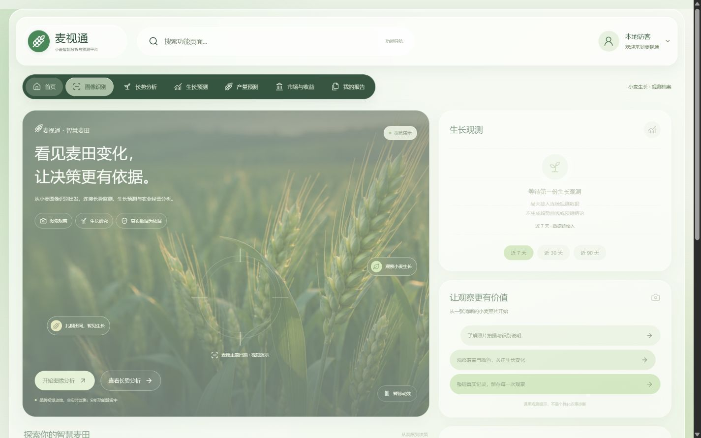
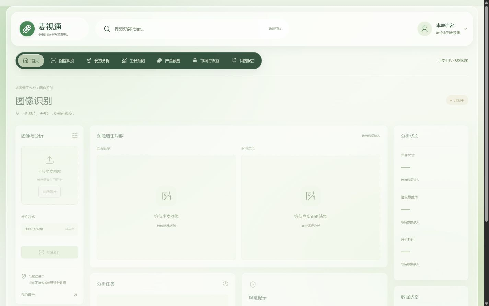

# 麦视通玻璃拟态主题升级

本轮只增加共享 CSS 主题，不修改页面业务逻辑、数据或路由。

## 文件

- 新增 src/styles/glass-theme.css：浅绿暖白渐变、柔和光影、深绿玻璃导航、白色磨砂顶部栏、分层面板、回退与响应式规则。
- 修改 src/main.js：加载玻璃主题。
- 新增 docs/glass-home.jpg、docs/glass-workbench.jpg：浏览器实际截图。

当前项目使用横向七项胶囊导航；保留现有位置，升级为深森林绿玻璃，不额外创建左侧栏。动态首页及二级工作台结构均保留。

## 视觉实现

默认使用不透明面板，支持 backdrop-filter 或 -webkit-backdrop-filter 时再启用半透明背景。
顶部栏 18px、导航 14px、内容面板 10px 模糊；窄屏内容降至 5px，并提高不透明度。不对整个页面叠加全屏背景滤镜。
背景为渐变光影，通过伪元素缓慢位移；用户选择减少动态效果时停止光影与页面淡入。麦田图片未加磨砂覆盖，原图片与扫描动效保留。
辅助文字加深为灰绿色，避免透明表面上文字过淡。弹出菜单保留较高不透明度。

## 实际验收

- npm.cmd run build 成功，退出码 0，最终构建 2.64 秒。
- 七页在 1920×1080、1440×900、1366×768、390×844 下完成 28 次布局检查，均无横向溢出。
- 七项导航 aria-current 均正确。
- 浏览器计算样式确认面板背景 rgba(255,255,255,0.72)，滤镜 blur(10px) saturate(1.12)。
- 检查首页、图像工作台截图，导航和主标题保持清晰，麦田画面保留。
- 麦田动画暂停后状态为 paused；继续播放可用。
- 图像识别卡片与主按钮跳转成功。
- 最终浏览器 warning/error 日志为空。
- 已提供不支持滤镜的不透明 CSS 回退，但未在旧版不支持滤镜的浏览器中实机测试；未做 GPU 性能基准测试。

## 查看

在 frontend 目录运行 npm.cmd run dev，打开 http://127.0.0.1:5173/#/ 。已运行时刷新即可。

