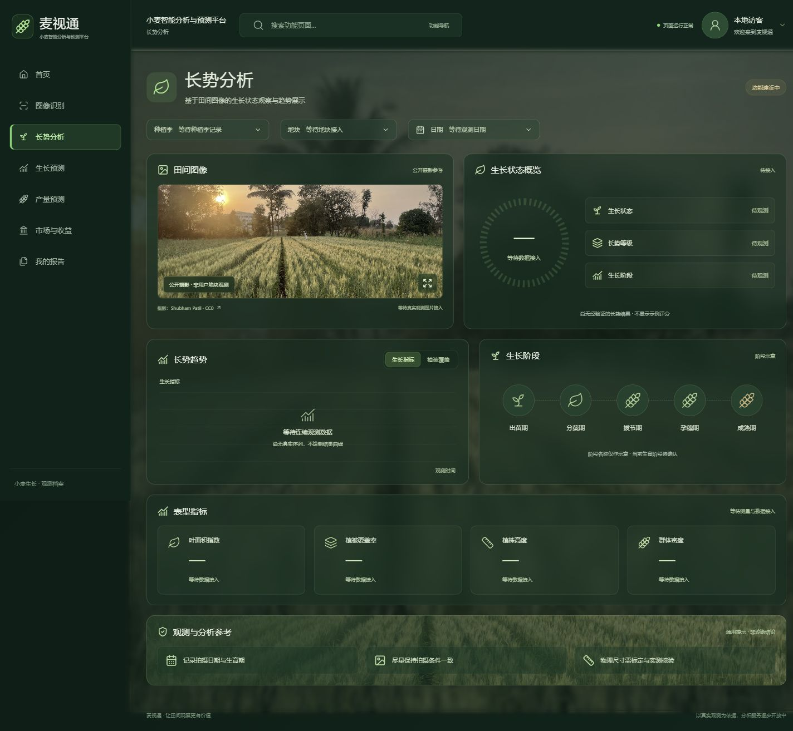

# 长势分析页精修与验收

日期：2026-11-14。本轮只重写长势分析页面，新增该页专用背景照片；未修改共享主题、路由、其他页面、Python 或实验数据。

## 修改文件

- src/views/GrowthAnalysis.vue：独立页面布局与 scoped 样式。顶部筛选、田间参考照片、状态环、三项状态、趋势空状态、五阶段轴、四项表型指标、图片化通用提示、照片放大对话框。
- src/assets/growth-wheat-field-photo.jpg：新增公开实拍照片。
- docs/growth-analysis-refined.jpg：实际浏览器全页截图。
- docs/growth-analysis-refinement.md：本报告及照片许可记录。

## 数据和交互边界

种植季、地块、日期没有真实记录，因此筛选项禁用并显示等待提示。趋势标签切换只改变展示指标名称，不生成曲线。状态环使用均匀虚线圆环，不表示已测比例。五个生长阶段是示意，不高亮当前阶段。

叶面积指数、植被覆盖率、植株高度、群体密度全部显示“— / 等待数据接入”，没有使用参考图中的示例成绩。提示区只有通用拍摄与测量建议，不是诊断或预测结论。

田间展示照片明确注明“公开摄影 · 非用户地块观测”。它是公开摄影参考，不能解释为用户上传图片、当前监测地块或真实分析结果。点击放大按钮可打开原照片，点击关闭或 Escape 关闭。

## 照片来源与许可

- 作者：Shubham Patil。
- 来源页面：https://wordpress.org/photos/photo/85367c5c45/
- 来源说明：A lush green wheat field with evenly spaced rows under a sunset sky.
- 原始尺寸：4032 × 2268。
- 本地使用发布者提供的 Large 版本：2048 × 1152，510486 字节。
- 下载地址：https://pd.w.org/2025/03/85367c5c4517afd54.48314224-2048x1152.jpeg
- 许可：CC0 https://creativecommons.org/publicdomain/zero/1.0/
- 来源页面标明其为投稿者原创摄影并采用 CC0。图片文件未做像素修改，页面使用 CSS 裁切、背景虚化与深色遮罩。页面内保留作者与来源链接。

## 实际验收

- npm.cmd run build：成功，退出码 0，4.04 秒。
- 1920×1080、1440×900、1366×768、390×844：无横向溢出，照片加载成功，五个阶段和四项空值指标完整。
- 照片放大对话框打开、关闭按钮及 Escape 关闭：通过。
- 趋势切换至植被覆盖：通过，仍保持无数据空状态。
- 三个筛选项均为禁用，未展示未经确认的日期、季节或地块。
- 首页原动态看板、图像识别原工作台均仍可访问，长势页 scoped 结构未出现在这些页面。
- 浏览器 warning/error 日志为空。
- 路由文件未修改；本轮没有开展模型测试、训练或真实图像分析实验。

访问 http://127.0.0.1:5173/#/growth-analysis 。服务器停止时，在 frontend 目录执行 npm.cmd run dev。

