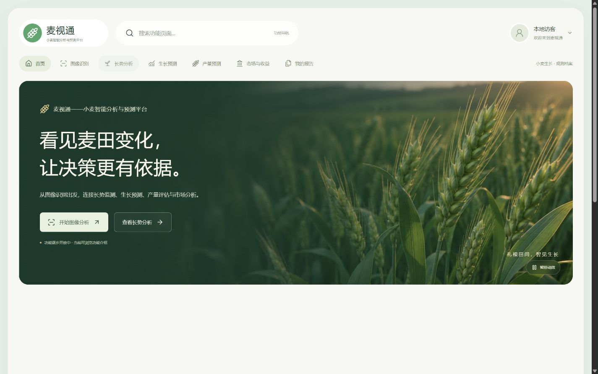
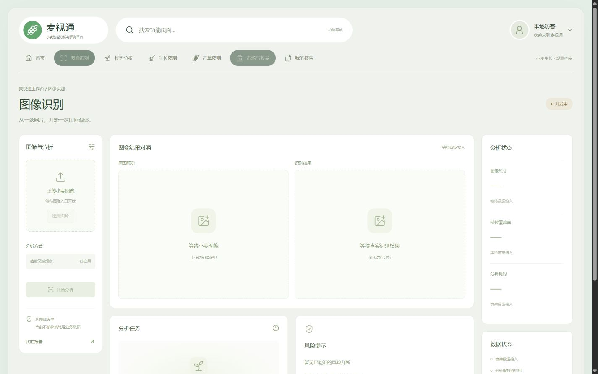

# 麦视通 P1 / P2 页面风格分层
日期：2026-11-14

## 页面变化

| 页面 | 呈现方式 |
| --- | --- |
| 首页（P1） | 宽幅动态麦田、指定品牌与标语、两个主入口、五张图像入口卡、四个项目亮点、报告入口 |
| 图像识别（P2） | 左侧上传与分析操作，中间原图/识别结果对照，右侧状态指标 |
| 长势分析（P2） | 当前状态主图、覆盖率/生长阶段/等级空卡、近期趋势和风险提示 |
| 生长预测（P2） | 趋势图空状态、观测时间线、预计成熟时间和风险提示 |
| 产量预测（P2） | 预计亩产主卡、趋势图、预测/实测对比和状态卡 |
| 市场与收益（P2） | 全国价格与收益空卡、未来30天趋势占位、成本环形空状态 |
| 我的报告（P2） | 筛选区、报告列表空状态、禁用的查看和导出操作 |

所有指标均使用“—”，所有图表均为空背景加等待提示。不绘制数值曲线、柱条或占比。预计成熟时间没有填入日期。时间线无实际阶段与时间点。报告列表无示例条目。

首页的诊断、经营参考等亮点明确标为研究/规划方向，不宣称已验证的业务能力。品牌素材只出现在首页，不作为用户分析结果。

## 文件清单

修改：
- src/views/Home.vue：品牌首页，保留可暂停麦田动效，使用轻量 IntersectionObserver 滚动渐显并在退出时清理。
- src/App.vue：根据现有路由选择 P1/P2 外壳样式。
- src/components/ModulePage.vue：六个主业务页复用新工作台；其余旧工具页保留原展示。
- src/main.js：加载分层样式。
- README.md：新增分层说明入口。

新增：
- src/components/WorkspacePage.vue：六种业务工作台的配置与布局。
- src/components/VisualEmpty.vue：统一图像、趋势、环形、报告等空状态。
- src/styles/product-layers.css：P1 品牌和 P2 工作台独立样式及响应式。
- docs/p1-p2-layering.md：本说明。
- docs/p1-brand-home.jpg、docs/p2-image-workbench.jpg：浏览器实拍对照图。

没有修改 Vue Router 文件、Python、后端、数据或实验结果，没有安装额外依赖。六个既有页面文件继续通过 ModulePage 调用，不复制路由。

## 实际验收

- npm.cmd run build：成功，退出码 0，2.48 秒。
- 1920×1080、1440×900、1366×768、390×844 各检查七页，共 28 次布局检查：无横向溢出，首页识别为 P1，其余六页为 P2。
- 七个导航均正常切换；首页五个卡片、两个主按钮分别进入对应原有路由。
- 上传、开始分析、报告查看和导出保持禁用；检查中三个指标值均为“—”。
- 首页动效暂停后计算样式为 paused；支持系统减少动态效果偏好。
- 最终浏览器 warning/error 日志为空。

## 运行

在 frontend 目录执行 npm.cmd run dev。
访问 http://127.0.0.1:5173/#/ ，从导航切换到二级页查看 P2。

