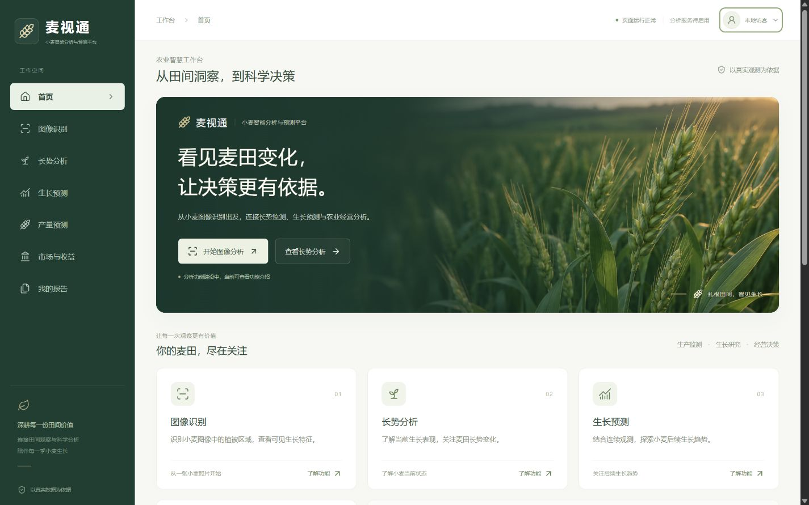

# 麦视通首页品质升级与验收记录

日期：2026-11-13。本轮仅调整 frontend 的首页、共享外壳与样式，没有增加业务接口。

## 改动文件

| 文件 | 内容 |
| --- | --- |
| src/views/Home.vue | 新主视觉、三列功能区、最近记录空状态、真实功能阶段 |
| src/App.vue | 标识与侧栏细节、面包屑、页面状态、本地访客菜单 |
| src/styles.css | 森林绿与暖白共享色彩、顶部与侧栏精修 |
| src/styles/home.css（新增） | 首页专用排版、主视觉、卡片、记录与进度、自适应 |
| src/assets/wheat-field-brand.png（新增） | AI 生成的品牌装饰图片 |
| README.md | 增加本轮说明入口 |
| docs/premium-home-upgrade.md（本文件） | 改动、素材与验收记录 |
| docs/premium-home-1920.jpg、premium-home-1440.jpg、premium-home-1366.jpg | 三种目标尺寸的全页浏览器截图 |
| docs/premium-home-preview.jpg | 1440 × 900 首屏浏览器截图 |

原有路由文件和六个业务页入口均已进行前后 SHA256 对照。原来的首页截图保持原位。

## 视觉与交互

- 颜色：深森林绿 #173F32、主绿色 #477653、浅绿色 #E8F0E5、暖白 #F7F8F4、白色卡片；少量麦穗金色。
- 首页沿用现有导航信息，使用三列网格。五张卡片中的市场卡片跨两列，平衡第二行空间。
- 标题与副标题使用本轮指定文案，两个主视觉入口分别进入图像识别与长势分析。
- 顶部状态仅表示页面浏览正常，明确分析服务待启用；没有声称后端健康监测。
- 本地访客菜单可进入我的报告，并明确说明账号登录未启用；支持 Escape 关闭和切换页面收起。
- 最近记录不读取本地实验目录，显示“暂无可查看的历史记录”，不填充示例业务数据。
- 功能阶段区分已完成、开发中、待启用，不展示准确率、分析次数、百分比或预测成绩。

## 实际验收

- npm.cmd run build 成功，退出码 0，用时 1.20 秒；图片已被 Vite 正式打包。
- 三个目标尺寸均检测到三列网格、无横向溢出、图片加载完成、侧栏无需内部滚动：

| 视口 | 主视觉高度 | 网格列数 | 横向溢出 |
| --- | --- | --- | --- |
| 1920 × 1080 | 420 像素 | 3 | 无 |
| 1440 × 900 | 385 像素 | 3 | 无 |
| 1366 × 768 | 370 像素 | 3 | 无 |

- 七个主导航逐一点击，高亮与当前页面一致，未观察到横向溢出。
- 首页五张卡片逐一点击，均进入对应原有路由。
- “开始图像分析”“查看长势分析”“前往图像识别”逐一验证，均跳转正确。
- 访客菜单的“我的报告”跳转成功，切换页面后菜单收起；Escape 关闭验证成功。
- 已检查全页截图中的记录空状态与功能进度布局。
- 编辑期间曾因首页先引用尚未写入的样式文件产生一条热更新错误。文件补齐后构建成功，最终完整刷新后的新增 warning/error 日志为空。

## 素材来源

使用内置 image_gen 工具，非 CLI。图片为 AI 生成的品牌装饰，**不是实验图片、真实田间采样或模型识别结果**，不得加入数据集或用作科研验证。保留在 frontend/src/assets/wheat-field-brand.png，原生成文件也保留，没有借用已有实验图像。

最终提示词：

> Create a premium editorial wheat field photograph for the hero banner of 麦视通, a professional agriculture technology SaaS product. Wide cinematic landscape composition, approximately 2.5:1. Dense real-looking green wheat heads and leaves in a cultivated field in soft late afternoon backlight. Distinct elegant wheat spikes in foreground on the RIGHT half, shallow depth of field, nuanced forest greens #173F32 and sage #477653, very subtle restrained warm gold sunlight on awns, refined natural photographic texture. LEFT half is calm very dark forest-green defocused negative space to overlay white UI text. The right half should be beautiful, tactile, with luminous wheat awns and a subtle distant field horizon. Premium natural commercial photography, understated and credible, no neon, no artificial science fiction holograms, no charts, no machinery, no people, no text, no logos, no watermark. This is a decorative brand image, not scientific evidence.

## 查看

在 frontend 目录执行 npm.cmd run dev，访问 http://127.0.0.1:5173/#/ 。开发服务器已运行时刷新即可。

