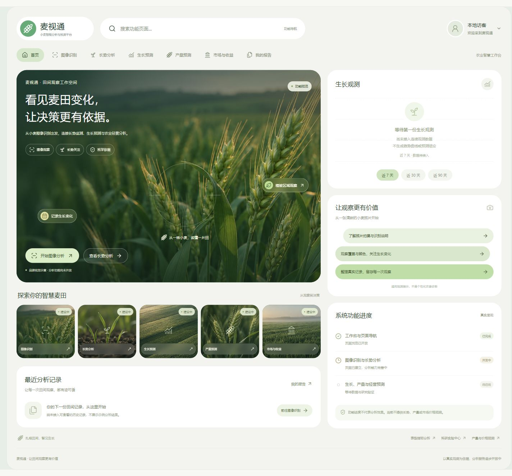

# 麦视通：参考农业仪表盘风格改版

日期：2026-11-13。

本轮依据用户提供的《Agtech Company Dashboard by Kyrylo Soliar for SOLAR Digital on Dribbble》参考图重排前端。借鉴浅灰画布、大圆角面板、麦田主画面、胶囊控件与右侧纵向卡片的视觉语言，没有使用参考图内的图片、品牌名称或业务数值。

## 实际改动

- 修改 src/App.vue：将七个现有路由入口保留为顶部胶囊导航，加入品牌区、可用的功能页面搜索与本地访客菜单。
- 修改 src/views/Home.vue：大幅麦田观察区、静态视觉标记、五个照片式功能入口、最近记录空状态、右侧观测信息和功能状态。
- 修改 src/styles/home.css：首页双栏、照片卡片、圆角面板、胶囊按钮及响应式规则。
- 新增 src/styles/workspace.css：浅色共享外壳、顶部搜索、导航与访客菜单。
- 新增 src/assets/agtech-card-scenes.png：四场景品牌图片图集。
- 修改 README.md：加入本轮文档入口。
- 新增本说明与 reference-dashboard-1920.jpg、reference-dashboard-1440.jpg、reference-dashboard-1366.jpg、reference-dashboard-preview.jpg 浏览器截图。

没有修改路由定义、六个业务页入口、Python 算法、数据或实验结果。没有新增识别与预测接口。

## 功能与数据边界

- 主画面标注“功能预览”“品牌视觉示意”，中央观察框为静态装饰，不代表实时扫描。
- 右侧生长观测没有伪造曲线、图表读数、长势比例或传感器信息。
- 时间范围按钮可切换“近 7 天 / 近 30 天 / 近 90 天”，只更新范围空状态，不查询不存在的数据。
- 观测提示是通用信息与真实页面入口，不构成病害诊断或个性化农事建议。
- 搜索在现有导航中查找功能页面；匹配结果可以点击跳转，无结果时明确提示。
- 本地访客入口如实提示账号登录未启用，可进入我的报告。
- 最近记录显示尚未接入历史记录，不把已有科研产物冒充用户分析历史。

## 本轮实际验收

- 最终 npm.cmd run build 成功，退出码 0，构建耗时 1.21 秒。
- 七个主导航的当前页面状态均为 aria-current=page；五个图片入口逐一跳转成功。
- 两个麦田主按钮、最近记录入口及三个观测提示入口跳转正确。
- 搜索“产量”可以进入产量预测；不存在的关键词显示“没有匹配的功能页面”；切换页面后搜索词清空。
- 观测时间范围切换后 aria-pressed 与对应空状态文字一致。
- 本地访客中的“我的报告”跳转成功，页面切换后菜单收起。
- 完整刷新后，本轮验收时间范围内没有新增 warning/error 控制台日志。

| 检查视口 | 首页横向溢出 | 主图片加载 | 页面布局 |
| --- | --- | --- | --- |
| 1920 × 1080 | 无 | 成功 | 左主画面、右信息卡片 |
| 1440 × 900 | 无 | 成功 | 左主画面、右信息卡片 |
| 1366 × 768 | 无 | 成功 | 左主画面、右信息卡片 |
| 390 × 844 | 无 | 成功 | 单列、导航换行 |

检查后修正了手机上预览标识遮挡中央说明的问题。桌面截图与最终全页预览保存在 docs/，旧版截图继续保留。

## 品牌素材来源

- 原有 src/assets/wheat-field-brand.png 继续作为主视觉使用。
- 新图集 src/assets/agtech-card-scenes.png 使用内置 image_gen 工具生成（非 CLI）。
- 两者都是 AI 品牌装饰，不是实验数据、实际地块采样或分析成果。图集仅通过 CSS 选择四个独立场景，不对科研图片做处理。

新图集最终提示词：

> Create a 2 by 2 contact sheet containing exactly FOUR equal square editorial agriculture photographs, arranged edge-to-edge in a precise 2x2 grid with NO gutters, NO borders, NO text or labels. Whole canvas square. These are decorative thumbnail assets for a premium Chinese wheat agriculture dashboard. Each tile is an independent photograph. TOP LEFT: aerial diagonal view of lush cultivated wheat fields with graceful alternating green field strips and soft morning light, no buildings. TOP RIGHT: a few fresh young wheat grass seedlings emerging from textured dark soil, close-up, natural defocused olive background, accurate narrow grass leaves. BOTTOM LEFT: mature elegant green wheat ears gently backlit against a dark forest green blurred field, close-up. BOTTOM RIGHT: a wide lush wheat field with a clear simple horizon and morning mist, elevated slightly diagonal view, deep muted greens. Consistent restrained natural photographic style, realistic tactile details, sage and forest greens, gentle pale gold highlights, calm premium agtech brand mood, no neon, no drones, no people, no logos, no watermarks, no numbers, no charts. Do not combine scenes inside a tile. Four equal square tiles filling the entire frame.

## 运行方式

在前端目录运行：

```powershell
cd D:\Desktop\wheat\source-code\wheat-phenotyping\frontend
npm.cmd run dev
```

浏览器访问 http://127.0.0.1:5173/#/ 。已有开发服务器运行时刷新即可。



