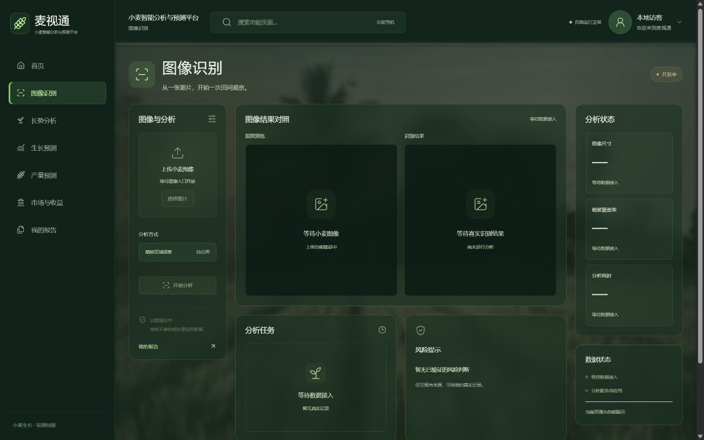
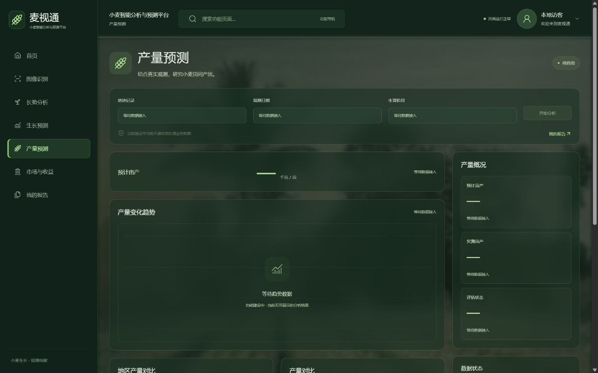

# 长势页视觉规范推广

## 结果

以已确认的长势分析页为视觉基准，将实拍麦田全幅背景、深绿色遮罩、深绿半透明玻璃面板、标题图标、细边框、指标卡和筛选条件规范推广到其他主页面。

- 首页：统一背景与信息面板，保留原动态麦田及暂停/播放交互。
- 图像识别：保留左侧上传占位、中间原图/结果对照、右侧指标；原图和结果不使用品牌照片冒充。
- 生长预测：顶部横向条件区、趋势/时间线/成熟时间与风险占位。
- 产量预测：顶部横向条件区、亩产卡、趋势与地区对比。
- 市场与收益：顶部经营条件、全国价格/收益卡、趋势与成本结构。
- 我的报告：顶部筛选区、报告列表空状态、预览与来源。

未接入的读数仍为空值，操作仍禁用。不新增分析、预测、上传或经济业务。长势分析页面文件和 Vue Router 文件的 SHA256 前后对照一致。

## 文件

修改：
- src/components/WorkspacePage.vue：统一标题图标、展示样式类和背景来源说明。
- src/views/Home.vue：添加首页统一样式类和背景来源说明；原动画与业务入口保持。
- src/main.js：引入统一样式。

新增：
- src/styles/reference-unified.css：只匹配 reference-extension 与 reference-home，不匹配原长势页。
- docs/reference-style-rollout.md：本说明。
- docs/unified-home.jpg、unified-image.jpg、unified-forecast.jpg、unified-yield.jpg、unified-market.jpg、unified-reports.jpg：浏览器实拍预览。

没有修改共享导航结构、Python、数据或实验结果。

## 素材与边界

复用长势页已核实的 CC0 实拍背景，摄影 Shubham Patil：
https://wordpress.org/photos/photo/85367c5c45/
图片许可及下载信息见 growth-analysis-refinement.md。各页保留来源及“非用户地块观测”说明。首页原品牌图和动效保持，不将其作为用户分析结果。

## 验收

- 最终 npm.cmd run build 成功，退出码 0，2.35 秒。
- 七页在 1920×1080、1440×900、1366×768、390×844 下完成28次布局检查：无横向溢出，导航 aria-current 均正确。
- 检查图像识别和市场页实际画面，玻璃面板与实拍背景正常呈现。
- 图像上传入口仍禁用，没有伪称已接入上传服务。
- 首页动画暂停后状态为 paused，再次点击可播放。
- 最终浏览器 warning/error 日志为空。
- 长势页和路由文件哈希保持一致。

## 查看

在 frontend 目录运行 npm.cmd run dev，访问 http://127.0.0.1:5173/#/ ，通过左侧导航切换页面。

