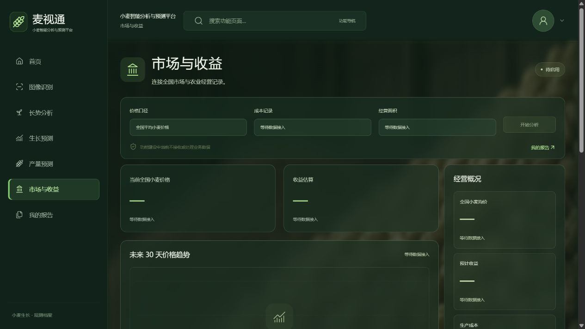
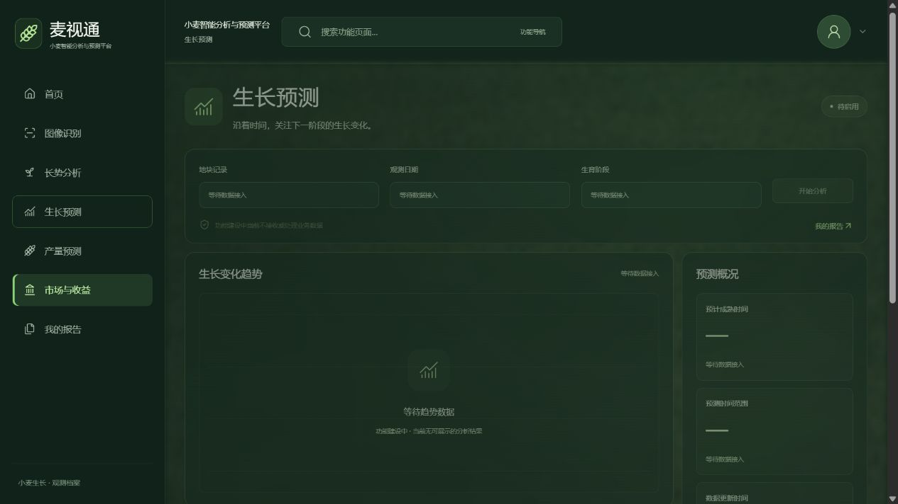

# 不同页面使用不同农业背景

## 分配

| 页面 | 场景 |
| --- | --- |
| 首页 | 农田全景（既有 AI 品牌图集左上景） |
| 图像识别 | 麦穗近景（既有 AI 品牌图片） |
| 长势分析 | 保留原 CC0 实拍麦田，不修改该页 |
| 生长预测 | USDA 绿色小麦田实拍 |
| 产量预测 | USDA ARS 成熟麦田实拍 |
| 市场与收益 | 仓储麦粒（既有 AI 品牌图集右下景） |
| 我的报告 | 晨雾田野（另一张既有 AI 品牌图集右下景） |

七种画面来自六个图片文件；首页/市场使用同一图集的两张不同场景，不是把同一照片仅换色。保持原有虚化、遮罩与玻璃内容。素材仅作装饰，绝不放入用户原图、识别结果或实验数据。照片与 AI 场景在页面底部分别说明。

## 文件

新增 src/config/backgroundScenes.js：背景选择、取景位置、素材来源及样式变量。
新增 src/assets/wheat-usda-field.jpg、src/assets/wheat-usda-nebraska.jpg：公开摄影素材。
修改 src/styles/reference-unified.css：页面背景读取 CSS 变量。
修改 src/components/WorkspacePage.vue、src/views/Home.vue：绑定场景并更新真实素材说明。
没有修改路由、Python 或实验数据。

## 新增照片来源

1. wheat-usda-field.jpg，1280×853：USDA / Lance Cheung，2020-05-20，Wheat (20200520-NRCS-LSC-0007)。来源页标注 PD USDA / 公共领域。
来源：https://commons.wikimedia.org/wiki/File:Wheat_(20200520-NRCS-LSC-0007).jpg
下载：https://thumb.wikimedia.org/wikipedia/commons/thumb/9/90/Wheat_%2820200520-NRCS-LSC-0007%29.jpg/1280px-Wheat_%2820200520-NRCS-LSC-0007%29.jpg

2. wheat-usda-nebraska.jpg，640×412：USDA ARS / Stephen Ausmus，Image Number K11701-1，Wheat in a Nebraska field。
来源：https://www.ars.usda.gov/oc/images/photos/mar22/k11701-1/
下载：https://www.ars.usda.gov/ARSUserFiles/oc/images/photos/mar22/K11701-1.jpg
页面保留摄影来源，不宣称拥有照片版权或将其作为用户当前地块记录。

既有 WordPress 摄影许可见 growth-analysis-refinement.md。既有 AI 素材说明见 agriculture-scenes-upgrade.md 等原素材记录。本轮没有新生成 AI 图片。

## 实际验证

- 最终 npm.cmd run build 成功，退出码 0，1.63 秒。
- 逐页读取实际背景 URL、尺寸与位置，确认七个场景配置不同。
- 七页均无横向溢出；导航切换正常。
- 新照片已下载、解码并人工查看。
- 浏览器 warning/error 日志为空。

访问 http://127.0.0.1:5173/#/ ，通过左侧导航比较各页背景。

