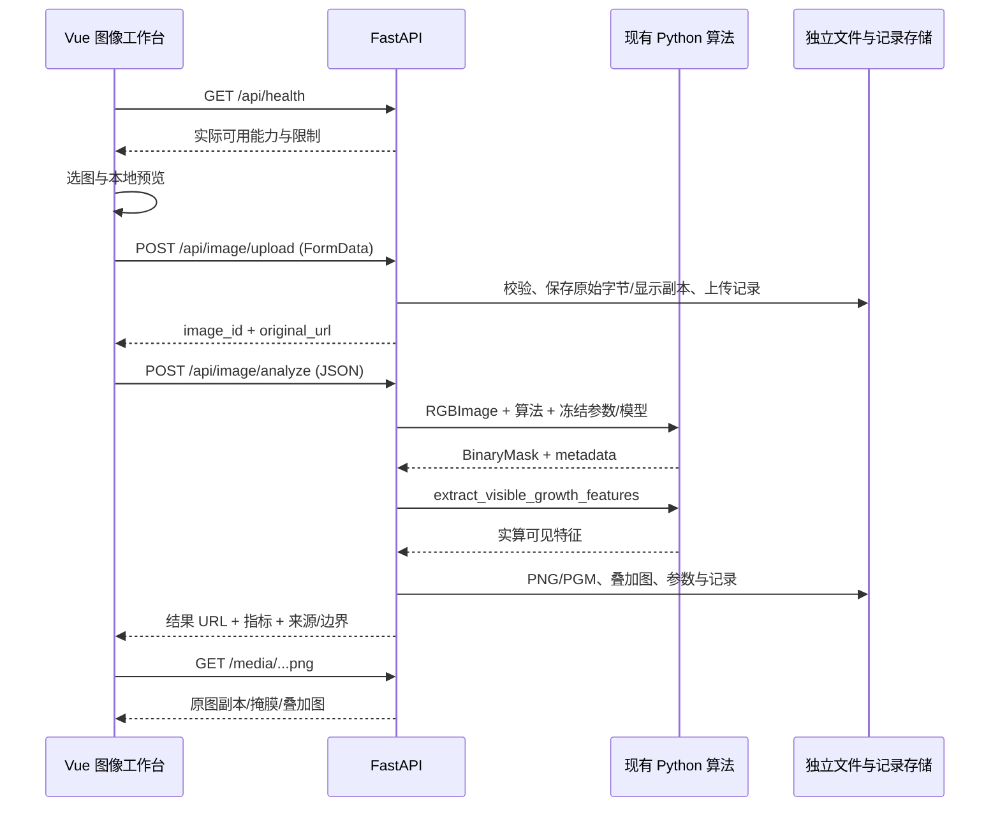

# 麦视通 Web 图像识别后端接入实施方案

检查日期：2026-11-14。项目根目录：`D:\Desktop\wheat\source-code\wheat-phenotyping`。下文文件路径均相对此根目录。

本轮只读检查源码、依赖与既有产物，仅新增本报告。未创建后端、修改 Vue/Python、安装依赖、下载数据、加载 RF 模型、训练或执行图像推理；未运行会生成缓存或产物的 pytest、npm build。目录树、接口、启动命令和验收项目均为**后续实施设计，不表示已经实现或通过测试**。

## 1. 检查结论

可以增量接入，无须重写算法。推荐调用链为 `FastAPI 服务适配层 → app.inference.predict_visible_mask → 现有注册器或 RF 推理 → 可见特征提取 → 文件与记录保存`。

Python 已有常见图像解码、四种传统分割、RF 推理、未标注单图/批量分析、可见特征计算。Vue 图像识别页目前只有展示容器，**尚无可用的网页选图、上传、原图预览、分析请求或结果回填**。Tkinter 本地文件选择不等于网页上传。

首版能提供的是“活体植被与非活体/背景分割及画面可见指标”。目前不提供小麦物种鉴别、叶/茎/穗器官识别、经农学验证的长势诊断或未来预测。任意绿色物体也可能被算法判为植被，接口不能承诺所有上传图均为小麦。

### 本轮检查证据

- 使用 `.venv\Scripts\python.exe -B` 检查 Python 和已安装包元数据，并实际导入下面的核心函数、读取函数签名及注册表；`-B` 避免生成 Python 字节码缓存。
- 核心函数导入成功，`DEFAULT_REGISTRY.names()` 实际为 `('ExG', 'HSV', 'Otsu-ExG', 'ExG-HSV Fusion')`。这是导入检查，不是本轮图像推理或端到端测试。
- EWS `manifest.csv` 有 190 行，train 142、validation 24、test 24；逐行解析相对路径后，190 对图像/掩膜引用均存在。本轮没有逐张重新解码或复核标签。
- 既有 `results/ews/test_evaluation/image_metrics.csv` 有 96 条 `ok` 记录，四算法各 24 条、样本集合一致，`is_double_empty` 均为 False。既有 `rf_test_evaluation/image_metrics.csv` 有 24 条 RF `ok` 记录。这些是历史产物，不是本轮生成的成绩，也不证明 Web 链路已经运行。
- 旧报告 `reports/web_system_development_plan.md` 中“尚无 frontend”等描述已过时；本方案依据本次源码和环境检查，不沿用旧环境结论。

## 2. 现有算法代码清单与实际接口

### 2.1 共用数据格式

| 类型 | 实际定义 | 约定 |
|---|---|---|
| `RGBImage` | `rgb_preprocessing/preprocessor.py` | `width: int, height: int, pixels: bytes`；行优先 RGB，通道 0–255，长度为宽×高×3；构造时检查尺寸 |
| `BinaryMask` | `leaf_segmentation/exg.py` | 宽高和行优先字节；只允许背景 0、前景 255，长度为宽×高；`save_pgm(path)` 写 PGM P5 |
| `AlgorithmPrediction` | `leaf_segmentation/registry.py` | `mask: BinaryMask, metadata: Mapping[str, object]` |

以上模块均位于 `src/wheat_phenotyping/`。不要把算法输入直接换为上传字节、Pillow 对象或 OpenCV BGR 数组。

### 2.2 图像读取与预处理

| 文件 | 实际函数 | 输入 → 输出 | 接入判断 |
|---|---|---|---|
| `src/wheat_phenotyping/data/image_io.py:12` | `load_rgb_image(path: str | Path) -> RGBImage` | 本地路径 → 统一 RGB；非 PPM 通过 Pillow 解码、EXIF 方向校正、转 RGB | 可直接调用。Web 层先校验并保存受控上传文件；函数自身没有 Web 文件大小、像素数或格式白名单限制 |
| 同文件 `:68` | `load_sample_images(image_path, mask_path) -> tuple[RGBImage, BinaryMask]` | 图像与人工标注路径 → 同尺寸对象 | 用于有标注研究评价；尺寸不符拒绝，不缩放标注 |
| `src/wheat_phenotyping/rgb_preprocessing/preprocessor.py` | `read_ppm(path)`、`preprocess_rgb(image, *, max_size=None, normalize_brightness=False, target_mean=127.0)` | PPM 读入；可选最近邻缩小/亮度归一化 | 旧接口保留。Web 首版不静默缩图或调整亮度，不以 PPM 专用脚本作为入口 |

`load_rgb_image` 实际支持 PPM、PNG、JPEG、BMP、TIFF 等 Pillow 可解码格式；**Web 首版另设更窄白名单，仅接收 JPG/JPEG/PNG**。它的 `.convert('RGB')` 不是透明 PNG 的明确背景合成策略，需由服务适配层补齐规则，不能假设透明像素已经正确处理。

### 2.3 四种传统算法

| 算法 | 实现文件与实际函数 | 输入与输出 | 可直接调用与适配点 |
|---|---|---|---|
| ExG | `src/wheat_phenotyping/leaf_segmentation/exg.py:56`，`segment_leaves_exg(image, *, exg_threshold=20, min_component_area=0)` | `RGBImage` → `BinaryMask`；`2G-R-B > threshold` 为前景，可选四邻域小连通域去除 | 算法可调用；Web 不依赖函数默认值，应使用有来源的冻结配置；严格校验参数类型、范围 |
| HSV | `src/wheat_phenotyping/leaf_segmentation/hsv.py:34`，`segment_hsv(image, parameters)` | `RGBImage` + 参数映射 → `BinaryMask` | 可调用；六个阈值必须显式配置，不填造默认值 |
| Otsu-ExG | `src/wheat_phenotyping/leaf_segmentation/otsu.py:61`，`segment_otsu_exg_with_threshold(image, parameters=None)`；另有 `segment_otsu_exg` | 前者返回 `(BinaryMask, int)`，后者只返回掩膜；1021 桶 ExG 整数直方图自动阈值 | 可调用；保留每张图实算阈值；拒绝手工阈值冒充 Otsu |
| ExG-HSV Fusion | `src/wheat_phenotyping/leaf_segmentation/fusion.py:13`，`segment_exg_hsv_fusion(image, parameters)` | ExG 掩膜与 HSV 掩膜逻辑 AND → `BinaryMask` | 可调用；记录融合规则。现实现的小连通域去除在 ExG 分支、交集之前执行，不能描述为融合后处理 |

统一传统入口：`src/wheat_phenotyping/leaf_segmentation/registry.py` 的 `DEFAULT_REGISTRY.run(name, image, parameters) -> AlgorithmPrediction`。Otsu 包装返回 `computed_exg_threshold`、`threshold_method`，融合包装返回 `fusion_rule`。RF **不在这个四算法注册器里**。

实际参数约定：

- ExG：`exg_threshold` 范围 −510 至 510；`min_component_area` 非负。Web schema 应限定为严格整数，拒绝布尔值、字符串和非有限数，避免内部 `int(...)` 静默截断。
- HSV：`hue_min/hue_max` 为角度 `[0,360)`，允许跨 0°；`saturation_min/max`、`value_min/max` 为 `[0,1]`，每对 min≤max。不是 OpenCV 的 0–179 色相范围。
- Otsu：空参数 `{}`；可选 `method='exg_otsu'`。不接收固定 threshold。常量图退化规则已在实现中定义，不由 API 改写。
- Fusion：ExG 阈值 + HSV 六参数，可选 `min_component_area`；不接受未知参数。

### 2.4 统一推理与 Random Forest

`src/wheat_phenotyping/app/inference.py:26` 的实际签名：

```python
predict_visible_mask(
    rgb, method: str, *, model=None,
    parameters: dict[str, object] | None = None,
    probability_threshold: float = 0.75,
) -> tuple[BinaryMask, dict[str, object]]
```

- `method` 支持四种注册名及 `RF-Color-Texture`。四种传统算法转交 `DEFAULT_REGISTRY`；RF 使用传入模型的 `classes_`、`predict_proba`，找到类别 1 后按冻结概率阈值生成掩膜。
- RF 特征：`src/wheat_phenotyping/leaf_segmentation/rf_features.py` 的 `extract_pixel_features(image) -> numpy.ndarray`，形状为 `(height*width, 7)`。特征依次为 RGB、ExG、5×5 灰度局部均值、局部标准差、梯度幅值，必须保持训练时顺序。
- RF 推理按 256 行条带、上下各 2 行上下文处理高图像，减少特征峰值内存；不意味着任意大图都能安全处理。
- 模型文件 `results/ews/rf_training/rf_color_texture.joblib` 存在，35,487,605 字节。训练元数据 `training_metadata.json` 记录 sklearn 1.9.1、NumPy 2.5.4、142 张官方 train 图像及 7 个特征；当前安装版本一致。**本轮未反序列化模型，模型可实际加载、类别/特征数与条带推理一致性仍需实施时验证。**
- 服务应在生命周期中只加载受信任的固定本地模型，计算模型 SHA-256，核对类别和特征数，缓存模型；不接收用户上传模型、不接受客户端传入 `model_path`。模型加载失败时标记 RF 不可用，四种传统算法仍可使用。
- `scripts/evaluate_rf_segmenter.py` 的 `_make_predictor` 是研究脚本内部加载闭包，不作为 Web 服务入口；它采用整图特征预测。服务优先复用 `predict_visible_mask`，并在集成测试中核对两种路径在受控图像上的掩膜一致性。

批量入口 `app/inference.py:96` 的 `run_image_batch(image_paths, methods, output_dir, *, model, model_path, algorithm_parameters, rf_probability_threshold, source_root, progress, ...)` 已能保存逐图 PGM、PNG 叠加、`image_results.csv` 和 `run_summary.json`。它是同步磁盘批处理，逐图捕获异常；不宜在上传路由中直接调用并把错误行当成功结果。首版 API 调用单图函数，不重写批处理。

### 2.5 可视化：必须分清两种叠加图

| 已有能力 | 实际接口与输出 | Web 处理方式 |
|---|---|---|
| 有人工标注的误差叠加 | `visualization/segmentation_overlay.py:11`，`create_segmentation_overlay(image, reference, prediction, *, alpha=0.45) -> RGBImage`；`:48` 的 `write_segmentation_overlay(..., path, *, alpha=0.45) -> Path` 保存 PNG | TP 绿、FP 红、FN 蓝，必须提供真实 reference；不能用预测掩膜自己充当 reference |
| 无标注的预测区域叠加 | `app/inference.py` 的 `run_image_batch` 内已有 Pillow `alpha_composite` 逻辑，在预测前景加绿色透明层，保存 PNG | 可参考其现有展示约定；目前没有独立的单图叠加函数。新增 Web 服务层小型展示适配器，不改分割算法；明确标为“预测区域叠加”，不标为正确区域/置信度 |
| 浏览器二值掩膜展示 | 现有 `BinaryMask.save_pgm` 写 PGM | 保留可下载 PGM；另用 Pillow 生成无损灰度 PNG，像素严格为 0/255、尺寸不变，浏览器用 PNG |

### 2.6 表型与评价

`src/wheat_phenotyping/phenotyping/growth_grading.py:53`：

```python
extract_visible_growth_features(image: RGBImage, mask: BinaryMask) -> VisibleGrowthFeatures
```

可直接调用，再使用 `dataclasses.asdict` 转成可序列化字段；RGB 与掩膜尺寸必须一致。

| 真实字段 | 实际含义 | 前端合适名称 |
|---|---|---|
| `image_width/image_height` | 处理坐标系的图像像素宽高 | 图像尺寸 |
| `green_pixel_count` | 掩膜前景像素数 | 可见植被像素数 |
| `green_area_fraction` | 前景像素数 / 全图像素数，0–1 | 画面可见植被占比；显示百分比时乘 100 |
| `canopy_height_fraction/canopy_width_fraction` | 全部前景像素外接框高度/宽度占图像的比例 | 前景外接框高度比/宽度比；不是实际株高、冠幅 |
| `mean_rgb_in_mask` | 前景内 RGB 均值；空前景为 None | 前景平均颜色，空值显示“无前景” |
| `mean_exg_in_mask` | 前景内 ExG 均值；空前景为 None | 科研详情中的颜色指数，非长势分数 |

空前景时面积和外接框比例是实算 0，颜色均值为 null；不能统一渲染成分析失败，也不能解读为小麦死亡。

同文件 `classify_visible_growth(features, thresholds, *, data_source='unspecified')` 虽能输出弱/中/旺规则等级，但必须显式传入 `GrowthGradeThresholds`，现无经验证的农学界限，**首版 Web 不调用该分级函数**。不填叶面积指数、厘米株高、生育期、健康度、未来长势、亩产等尚不可计算的字段。

`evaluation/segmentation.py` 的 `evaluate_binary_masks(prediction, reference)` 实算 IoU、Precision、Recall、F1；普通上传无人工真值，不调用、不返回伪造精度。历史 EWS 精度只可在独立科研展示中注明数据集/版本/划分，不能当成当前照片准确率。

## 3. 冻结参数与已有 EWS 记录

| 用途 | 实际文件 | 核对结果 |
|---|---|---|
| 桌面五算法配置 | `configs/segmentation/desktop_frozen_defaults.json` | 具备四传统算法参数和 RF 概率阈值 |
| 四算法验证集所选参数 | `results/ews/validation_calibration/selected_parameters.json` | 参数值与桌面配置的四算法一致 |
| RF 验证集所选阈值 | `results/ews/rf_validation_refined/selected_parameters.json`、同目录 `experiment_metadata.json` | 阈值 0.75；元数据记为 validation 选择，`test_data_used_for_selection=false` |
| 已有四算法/RF 测试记录 | `results/ews/test_evaluation/`、`results/ews/rf_test_evaluation/` | 有逐图 CSV、汇总 CSV、SVG 与元数据；本轮只读核对 |

实际已保存的配置值如下，**不是本轮推荐的新阈值，也不是针对用户手机照片重新验证的最佳值**：

| 算法 | 已有冻结值 |
|---|---|
| ExG | `exg_threshold=20, min_component_area=0` |
| HSV | `hue_min=55, hue_max=145, saturation_min=0.1, saturation_max=1.0, value_min=0.15, value_max=1.0` |
| Otsu-ExG | `{}`，逐图自动计算 |
| Fusion | `exg_threshold=0, min_component_area=0, hue_min=55, hue_max=145, saturation_min=0.1, saturation_max=1.0, value_min=0.05, value_max=1.0` |
| RF | `probability_threshold=0.75` |

实施时将这些文件纳入只读参数档案，生成带版本和摘要的 profile。首版客户端只选算法和已批准 profile，不提交任意阈值。桌面配置的 `parameter_source` 文本主要指向 RF 元数据，无法单独解释所有传统阈值来源，因此服务记录要分别引用上表的传统校准文件与 RF 校准文件，不能只复制这一条说明。

EWS 本地摘要记录来源 `https://doi.org/10.3929/ethz-b-000512332`、论文 DOI `10.3389/fpls.2021.774068`、CC BY-SA 4.0。保持原始来源、许可证和 train/validation/test 划分。Web 上传照片另记 `user_upload` 来源和 `not_assigned` 划分，不写入科研 manifest、不自动进入训练或测试集。该上传记录枚举独立于现有 manifest 的 `VALID_SOURCES/VALID_SPLITS`，不为了接入 Web 修改现有校验器。

## 4. Vue 前端当前功能清单

实际渲染链：`router/index.js → views/ImageRecognition.vue → components/ModulePage.vue → components/WorkspacePage.vue`。

| 检查项 | 当前事实 | 后续最小改动 |
|---|---|---|
| 图像识别路由 | `/#/image-recognition`；Vue Router 哈希路由已配置 | 保留 |
| 上传组件 | `WorkspacePage.vue` 中内联展示区，选择图片和开始分析按钮均 `disabled`；没有独立真实上传组件 | 仅图像识别分支增加文件输入、事件和上传状态 |
| 本地原图预览 | `VisualEmpty` 占位，没有 `FileReader`/object URL/真实用户图片绑定 | 选图后本地预览；重新选图/卸载释放 object URL；上传成功以服务方向校正副本为准 |
| 结果预览 | 原图与识别结果两栏占位；分析任务和三项指标均为空 | 绑定服务返回的 PNG 掩膜/叠加 URL、真实尺寸、可见植被占比和耗时；新增掩膜/叠加查看切换 |
| API 请求 | `frontend/src` 未发现 `fetch(...)`、Axios、FormData 或请求服务封装 | 新增原生 fetch 封装，无须引入 Axios |
| API 服务配置 | `vite.config.js` 只有 Vue 插件及 `base:'./'`；未配置代理；前端根目录未发现 `.env*` | 后续增加 `/api` 和 `/media` 开发代理；按需增加 `VITE_API_BASE_URL` |
| 依赖 | `package.json` 为 Vue、Vue Router、lucide-vue-next；无网络请求库 | 原生 fetch 足够 |
| 共享页面 | 其他页面也依赖 ModulePage/WorkspacePage | 改动严格限定图像分支，避免把识别状态覆盖长势、预测、收益和报告页面 |
| 历史记录 | Web 结果和报告目前占位 | 先在后端保存记录，不顺带开发报告中心；历史查询接口另列后续任务 |

`ModulePage.vue` 还保留旧上传占位模板，但该路由优先进入 `WorkspacePage` 分支；只修改旧模板不会接通当前页面。装饰麦田背景不是用户上传或识别产物，不能用来填补结果预览。

## 5. 后端缺少的依赖与环境

本次实际检查解释器：`D:\Desktop\wheat\source-code\wheat-phenotyping\.venv\Scripts\python.exe`，Python 3.12.10、64 位。

| 包/组件 | 虚拟环境检查 | 用途与实施建议 |
|---|---|---|
| FastAPI | 未安装、模块不可发现 | 新增 API 框架依赖 |
| Uvicorn | 未安装 | 新增 ASGI 服务依赖 |
| python-multipart | 未安装 | 新增 multipart 文件上传解析依赖；不要误装名为 multipart 的其他包 |
| Pydantic | 未安装 | 请求/响应 schema；作为 FastAPI 依赖安装，直接使用时列入后端依赖清单 |
| Starlette | 未安装 | FastAPI 间接依赖；按兼容约束解析，不单独随意升版 |
| httpx | 未安装 | 后端 TestClient/API 集成测试的开发依赖 |
| Pillow | 12.3.0，模块可发现 | 已有图像解码/PNG 编码依赖 |
| NumPy / SciPy | 2.5.4 / 1.18.1，模块可发现 | 已有特征计算依赖 |
| scikit-learn / joblib | 1.9.1 / 1.6.0，模块可发现 | RF 推理/受信任模型加载；joblib 当前未在根 requirements 显式声明，是间接依赖 |
| pytest | 9.2.0 | 已有测试工具 |
| sqlite3 | 标准库可导入，SQLite 3.49.1 | 首版记录存储，不需要额外数据库服务或 ORM |

根 `requirements.txt` 当前声明 Pillow、numpy、scipy、scikit-learn，`requirements-dev.txt` 声明 pytest。项目没有 `pyproject.toml/setup.py/setup.cfg`，不能假设 `pip install -e .` 可用；运行后端需设置 `PYTHONPATH=项目根/src`。

实施阶段另建后端依赖清单，先约束已有研究环境的包版本，安装 Web 增量依赖后检查解析结果，执行 `pip check` 并锁定实际通过测试的版本。不在本报告虚构最新版本，也不无意升级 sklearn 后继续加载旧模型。文件上传使用 `UploadFile`，multipart 解析需 python-multipart；UploadFile 的临时文件机制不等于业务文件大小限制，需另行实现上限。[FastAPI 文件上传文档](https://fastapi.tiangolo.com/tutorial/request-files/)

## 6. FastAPI 目录与职责设计

以下均为拟新增文件/目录，本轮未创建：

```text
wheat-phenotyping/
├─ backend/
│  ├─ __init__.py
│  ├─ requirements.in               # 后端直接依赖，不替换研究清单
│  ├─ constraints-research.txt      # 实施时固定既有研究环境版本
│  ├─ requirements.lock.txt         # 实际安装、验证后锁定的依赖
│  ├─ requirements-dev.in          # API 测试依赖
│  ├─ app/
│  │  ├─ __init__.py
│  │  ├─ main.py                    # FastAPI、生命周期、路由及受限媒体挂载
│  │  ├─ config.py                  # 根路径、限额、CORS、模型/profile 路径
│  │  ├─ errors.py                  # 统一错误码与安全的中文提示
│  │  ├─ schemas.py                 # 请求/响应模型，禁止额外字段
│  │  ├─ api/
│  │  │  ├─ __init__.py
│  │  │  ├─ health.py               # GET /api/health
│  │  │  └─ image.py                # POST upload/analyze，保持薄路由
│  │  ├─ services/
│  │  │  ├─ __init__.py
│  │  │  ├─ image_validation.py     # 字节/格式/尺寸/EXIF/透明度策略
│  │  │  ├─ inference_service.py    # 调现有算法与特征，不复制算法
│  │  │  ├─ model_provider.py       # 受信任模型与冻结参数的加载/校验
│  │  │  ├─ image_rendering.py      # 预测掩膜 PNG 与无标注叠加图
│  │  │  └─ storage.py              # UUID 路径、原子写入、SQLite 记录
│  │  └─ repositories/
│  │     ├─ __init__.py
│  │     └─ analysis_records.py     # 上传与分析记录 CRUD 内部封装
│  └─ tests/
│     ├─ conftest.py               # 独立临时目录，不写 EWS
│     ├─ test_health.py
│     ├─ test_upload.py
│     ├─ test_analyze.py
│     └─ test_storage.py
├─ var/web/                        # 实施后运行时生成，与科研数据隔离
│  ├─ private/originals/<image_id>/source.jpg|source.png
│  ├─ private/records.sqlite3
│  ├─ private/records/<analysis_id>.json
│  ├─ private/masks/<analysis_id>.pgm
│  ├─ staging/                     # 未完成写入的临时文件，不公开
│  ├─ public/uploads/<image_id>/display.png
│  ├─ public/analyses/<analysis_id>/mask.png
│  ├─ public/analyses/<analysis_id>/overlay.png
│  └─ logs/
└─ frontend/src/
   ├─ services/imageApi.js         # 拟新增：上传、分析、健康检查
   └─ composables/useImageAnalysis.js # 拟新增：本次图像任务状态
```

使用 `backend.app` 包名，与已有 `wheat_phenotyping.app` 清晰区分。源算法、Tkinter、EWS、经济模块保持原样。`var/web` 后续加入忽略规则，防止用户图片/运行记录进入版本库，本轮不改 `.gitignore`。

## 7. API 接口设计

### 7.1 `GET /api/health`

返回 200 表示核心服务、存储和传统配置可用，字段包含服务版本、UTC 时间、`status=ok|degraded`、每个算法的可用性、RF 加载状态、允许格式及大小/像素限制。RF 不可用时 `degraded`，不可把模型文件存在等同于就绪；核心配置或存储不可用时 503。响应不泄露本地绝对路径。

首版不新增独立算法列表接口，可由 health 提供稳定算法名、普通用户显示名称和可用原因。中文页面显示“植被区域分析”等友好名称，科研详情保留真实算法名与版本。

### 7.2 `POST /api/image/upload`

- 请求：`multipart/form-data`，必填单个 `file`。Vue 使用 FormData，不手写缺少 boundary 的 Content-Type。
- FastAPI 使用 `UploadFile` 接收；只接受 JPEG/PNG，`.jpg/.jpeg` 均映射 JPEG。
- **拟定工程限额**：文件最多 10 MiB（10×1024×1024 字节）、解码后最多 4,000,000 像素、最长边最多 4096。均写入配置，并在后续容量测试中确认；不是已测性能保证，也不是算法阈值。超限拒绝并说明，不静默缩放原图。
- 检查扩展名、声明 MIME 与 Pillow 实际解码格式，实际内容为最终依据；错误 MIME 不当成可信证据，格式/扩展名冲突明确拒绝。不支持 GIF/WebP、动画 PNG、多帧、空文件、损坏或截断图像。
- 在读取过程中计数；仅检查 Content-Length 不够。需在 multipart 解析前的 ASGI 请求体限额和上传后文件计数两层限制，限制请求体时预留 multipart 开销；不能先无上限读入全部文件再校验。
- Pillow `verify` 后重新打开并完整解码；解压炸弹警告/异常转明确错误；在 RGB 转换前检查像素上限。
- 原始字节不变保存，计算 SHA-256。EXIF 方向校正、转 RGB，另存无损 `display.png` 供算法和前端对照；无方向旋转以外的重采样。透明 PNG 明确按固定白底合成并记录策略，不能让隐藏 RGB 值改变分析解释。原始与处理宽高、EXIF 变换分别记录。
- 返回 201：`image_id`、安全显示文件名、真实格式、字节数、原始/处理宽高、图像摘要、`original_url`、上传时间、归一化说明。`original_url` 指**方向统一的原图显示副本**，原始上传字节私有保留。此时不返回识别结果或精度。
- 上传 ID 由服务生成 UUID；不使用用户文件名拼接目录，不接受路径、远程 URL 或已有实验路径。

### 7.3 `POST /api/image/analyze`

请求为 JSON，字段设计：

| 字段 | 规则 |
|---|---|
| `image_id` | 必填服务已保存的 UUID，必须能在上传记录中找到且文件校验通过 |
| `algorithm` | 四传统注册名或 `RF-Color-Texture`；稳定字符串枚举，不接受任意模块名 |
| `profile_id` | 必填已批准的冻结参数档案版本；由后端解析，不信任客户端自报阈值/模型路径 |
| `client_request_id` | 必填 UUID，用于超时重试去重；同 ID 同负载返回已完成结果，负载冲突返回 409 |

首版请求中不提供任意 `parameters`、`split`、`reference_mask_path` 或 `model_path`。服务记录实际参数及其来源摘要，而不是只记录客户端算法名。

成功时返回 200，响应契约如下；表中是类型/来源，**没有填造实验数值**：

| 字段 | 类型/来源 |
|---|---|
| `analysis_id/image_id/status` | 服务 ID、关联上传 ID、`succeeded` |
| `algorithm/profile_id/parameters` | 本次实际运行的算法、配置版本和参数快照 |
| `algorithm_metadata` | 来自现有推理函数；Otsu 包含逐图自动阈值，Fusion 包含融合规则 |
| `images.original_url/mask_url/overlay_url` | `/media/...` 只读相对 URL；原图副本、二值预测 PNG、预测区域叠加 PNG |
| `image.width/height/coordinate_space` | 方向统一后的宽高，三张展示图使用同一坐标系 |
| `mask_encoding` | 明确 `background=0, live_vegetation=255`；不是 0/1 器官类别图 |
| `metrics` | `extract_visible_growth_features` 真实字段；不可计算的均值为 JSON null |
| `timing.segmentation_seconds` | perf_counter 包围单次 predict_visible_mask，含 RF 特征、传统算法处理，不含解码/保存 |
| `timing.total_seconds` | 本次分析请求服务端处理耗时，含读图、特征和产物保存；不含先前上传和网络传输 |
| `created_at_utc/completed_at_utc` | 带时区的真实 UTC 时间 |
| `provenance` | 用户上传来源、图像/参数摘要、算法版本；RF 附模型摘要、EWS 训练来源/版本 |
| `scope/warnings` | 活体植被/背景、可见比例代理量；不含器官/农学等级/预测结论 |

该接口不返回 IoU、Precision、Recall、F1、准确率或农学长势等级；也不将 RF 概率阈值当作整图置信度。首版只执行单算法，四/五算法对比逐次复用同一 `image_id` 与显示副本，保证输入一致。

### 7.4 图片访问与错误

三项 API 之外，还必须提供图片 URL 的 GET 访问，否则 JSON URL 不能显示图片。首版将 `/media` 只读挂载到 `var/web/public`，仅公开方向统一副本、PNG 掩膜及叠加图；不挂载整个项目、EWS、private、数据库或日志。不接受任意 filesystem path。FastAPI 支持以 StaticFiles 挂载指定目录。[FastAPI 静态文件文档](https://fastapi.tiangolo.com/tutorial/static-files/)

统一错误结构建议 `{ "error": { "code": "...", "message": "中文可操作提示", "request_id": "..." } }`，schema 校验错误也适配为此结构。

| HTTP | 错误示例 | 用户提示方向 |
|---|---|---|
| 400 | `INVALID_IMAGE`、空文件、无法完整解码 | 请选择有效 JPG/PNG 图片 |
| 404 | `IMAGE_NOT_FOUND` | 图片不存在，请重新上传 |
| 409 | 重试 ID 冲突/任务处理中 | 同一请求参数冲突，或原任务仍在处理 |
| 413 | `FILE_TOO_LARGE`、`IMAGE_TOO_LARGE` | 显示明确的大小/像素限制 |
| 415 | `UNSUPPORTED_IMAGE_FORMAT` | 仅支持 JPG/JPEG/PNG |
| 422 | 未知算法/profile、额外字段、参数类型错误 | 指明可修正的字段 |
| 503 | `MODEL_UNAVAILABLE`、`SERVER_BUSY`、`STORAGE_UNAVAILABLE` | 模型未就绪、任务繁忙或暂时无法保存，不能伪装分析成功 |
| 500 | `ANALYSIS_FAILED` | 分析未完成，提供 request_id；内部日志保留堆栈，前端不显示系统路径 |

空掩膜是有效分析结果，返回占比 0 和“未检出前景”提示；与上传失败、解码失败、推理失败区分。

## 8. 通信流程与运行约束



Vue 任务状态建议 `idle → selected → uploading → uploaded → analyzing → succeeded/failed`。上传期间显示“上传中”，分析期间显示“分析中”，不捏造完成百分比。重新选图清除旧结果；重复点击禁用，异步响应按请求 ID 核对，旧响应不能覆盖新图片。请求失败显示可操作中文提示，禁止用装饰背景顶替结果。

CPU 推理不能直接放在 async 路由的事件循环中；首版使用单个有界执行槽（线程池隔离阻塞调用），忙时返回 503，不无界排队。该设计不宣称 Python 循环获得并行加速。FastAPI 普通 def 路由会在线程池执行，但被 async 路由直接调用的普通辅助函数不会自动卸载。[FastAPI 并发说明](https://fastapi.tiangolo.com/async/)

高分辨率下 HSV/ExG 逐像素 Python 循环、Otsu 的逐像素列表、可见特征的索引/x/y 列表仍可能耗时和占内存。限额必须通过实测再放宽；RF 训练记录使用 `n_jobs=-1`，服务阶段也要测试 CPU 占用，不承诺响应时延。后续如需硬性超时/取消，增加受控独立进程；浏览器 AbortController 只停止等待，不保证服务端计算被中止。首版不使用不持久的 BackgroundTasks 冒充可靠任务队列。

开发环境优先由 Vite 同源代理 `/api`、`/media` 到 `http://127.0.0.1:8000`；所有 JSON 图片 URL 用相对路径，避免浏览器去 5173 找不存在的文件。如选择直接跨端口请求，显式配置 `http://127.0.0.1:5173` 和 `http://localhost:5173` 等实际前端来源，不使用任意来源通配。协议、主机或端口不同即为不同 origin。[FastAPI CORS 文档](https://fastapi.tiangolo.com/tutorial/cors/)

## 9. 图片存储与分析记录

1. 原始文件按服务器生成的 `image_id` 独立保存，记录原始 SHA-256；不覆盖同名文件，不更改 EXIF/原始字节。方向统一副本仅为推理和显示派生文件。
2. 每次分析使用独立 `analysis_id`，固定关联 `image_id`、源图摘要、profile 版本及摘要、算法代码版本/摘要、RF 模型摘要、处理策略、UTC 时间与状态。未知观测日期不从上传时间推断。
3. 用独立 SQLite `uploads/analyses` 表保存记录。请求先建立 processing 行，完成后更新 succeeded；错误则 failed 并保存安全错误码。元数据/指标可保存 JSON 字段，另写每次运行 JSON 快照；SQLite 是索引与状态依据，不以同名 CSV 覆盖历史。
4. 产物先写 staging，全部成功后原子转存，再提交成功状态；任一步失败都不得返回成功及半成品 URL。每请求独立数据库连接、短事务，不跨线程共享默认连接。
5. 启动时识别上次异常中断的 processing 记录并标记 interrupted。对“文件已提交、数据库提交失败”等情况记录待核查，实施时测试恢复；不自动删除科研文件。首版不做自动清理/过期删除，保留策略后续单独制定。
6. 当前 `run_image_batch` 的旧 `runtime_seconds` 含读图、推理、特征与写图，研究评价器又有自身计时约定。新接口分开记录推理耗时和总耗时，不把不同口径直接当算法性能排名。
7. 服务仅监听本机，public URL 仅用于本机研究原型；尚无用户隔离/认证，UUID 不是权限控制。未来对外部署前再增加访问权限，不在本轮扩展经济、报告中心等业务。

## 10. 前后端启动方式（实施后适用）

**以下命令本轮均未执行；后端文件和依赖尚不存在，当前不能据此宣称服务已经可启动。**

先在实施阶段生成和验证 backend 依赖锁文件，再在现有虚拟环境安装增量依赖并执行 pip check；不要将后端包安装到不确定的系统 Python。

后端 PowerShell：

```powershell
$projectRoot = 'D:\Desktop\wheat\source-code\wheat-phenotyping'
Set-Location -LiteralPath $projectRoot
$env:PYTHONPATH = Join-Path $projectRoot 'src'
& "$projectRoot\.venv\Scripts\python.exe" -m uvicorn backend.app.main:app --host 127.0.0.1 --port 8000
```

默认单工作进程，避免多个进程重复加载模型。开发确需热更新时可加 `--reload`，正式演示去掉；`module:app` 对应计划中的后端导入路径。[FastAPI 服务启动说明](https://fastapi.tiangolo.com/deployment/manually/)

前端另开 PowerShell：

```powershell
Set-Location -LiteralPath 'D:\Desktop\wheat\source-code\wheat-phenotyping\frontend'
npm.cmd run dev
```

前端现有 npm dev 配置已经固定 `127.0.0.1:5173` 和 strictPort。实施后浏览器入口：`http://127.0.0.1:5173/#/image-recognition`；后端健康检查：`http://127.0.0.1:8000/api/health`；交互文档：`http://127.0.0.1:8000/docs`。生产构建不继承 Vite 开发代理，正式部署需另配 `/api` 与 `/media` 同源转发，不以 `npm run build` 成功代替接口联调。

## 11. 分阶段实施步骤与验收标准

| 阶段 | 具体工作 | 必须实际验证的完成标准 |
|---|---|---|
| 1：服务骨架与上传 | 新增独立 backend、锁定 Web 依赖、health、受限存储、upload、错误 schema | health 反映真实能力；JPEG/PNG 上传产生 image_id 和可读原图副本；空文件、伪扩展名、超大小/像素、多帧和损坏文件被拒；原始摘要不变；不写 EWS |
| 2：单图 ExG 闭环 | 使用已有冻结 ExG 参数，接 predict_visible_mask、可见特征、PNG/PGM 和绿色预测叠加、记录 | API 与同 RGB/同参数直接调用的掩膜逐像素一致；三图尺寸/方向一致；掩膜仅 0/255；面积比例可由前景像素重算；无真值不输出精度或长势等级；失败不留成功记录 |
| 3：Vue 接通 | 真实文件选择、本地预览、两次请求、结果切换、真实指标/错误展示，仅图像分支改动 | 浏览器实际上传 JPG/PNG；原图/掩膜/叠加可查看；重复点击、换图和请求乱序不显示旧结果；服务停止能提示错误；其余路由正常；npm run build 实际成功 |
| 4：其余算法与 RF | 接入 HSV/Otsu/Fusion，生命周期加载固定 RF，profile 与模型来源入记录 | 五算法在相同 image_id 上调用；Otsu 阈值真实回传；fusion 与直接调用一致；RF 检查加载/类别/7 维特征和条带一致性；缺模型仅禁 RF，不谎报成功；不训练或调参 |
| 5：回归与容量验证 | API 单元/集成测试、记录恢复、桌面回归、桌面浏览器验收 | 现有相关测试与新 API 测试实际执行并记录通过/失败/跳过；原 EWS 产物不变；对允许尺寸记录实际耗时和峰值资源，决定是否调整工程限额；无未验证性能承诺 |

各阶段按可独立验收的增量交付。首个用户闭环完成后，再启用其余算法；不同时重构算法、经济模块或七页 UI。

### 必补测试重点

- 读取/坐标：JPEG、PNG、灰度、CMYK、EXIF 旋转、透明 PNG；方向统一副本与预测完全对齐；不插值修改人工标注。
- API 校验：零字节、截断图、伪 MIME/后缀、超限（包括没有 Content-Length 的请求）、目录穿越名称、未知 ID/算法/profile、重复请求 ID、异常额外字段。
- 真实计算：用明确标注为单元测试夹具的小图检查像素级结果和指标公式；这些测试数据不是新增小麦实验数据，不能据此报告真实准确率。使用已有 EWS train 样本作文件链路冒烟时仅验证对齐与可读性，写独立临时目录，不用于调阈值，不覆盖旧结果。
- 无标注边界：空前景、全前景、颜色均值 null；不调用需要 reference 的误差叠加；不展示 IoU/F1、健康分数、器官类别、厘米株高或生长预测。
- 存储/错误：模型缺失、损坏配置、输出路径不可写、文件写入/数据库提交失败、服务中断、忙状态、重试去重；不返回其他图片的历史结果。
- RF：加载与依赖版本核验、`classes_` 包含背景/前景类别、`n_features_in_` 与 7 特征匹配、条带边界一致性；原训练产物摘要不变。

现有测试文件包括 `tests/unit/test_data.py`（6 个 test_ 定义）、`test_traditional_segmenters.py`（11）、`test_photo_app.py`（5）、`test_visualization.py`（3）、`test_growth_grading.py`（3）、`test_rf_features.py`（2）等。本轮只读取测试内容/统计定义，没有重跑，以上数字**不是通过数**。`test_photo_app` 含模型文件存在才执行的 RF 测试，后续汇报必须区分 passed、failed、skipped。现有单元测试不覆盖尚不存在的 FastAPI 接口。

## 12. 下一步最应该开发的具体功能

**单张图片上传后的 ExG 真实分割闭环**：用户选 JPG/PNG → 上传校验并获得 image_id → 后端调用已有 ExG → 保存并返回原图副本、二值 PNG、预测叠加图及实算可见植被占比 → Vue 对照展示。

先完成阶段 1 和 2 的后端验收，再完成阶段 3 的网页联调。采用已有 ExG 冻结配置，便于逐像素核验链路，既不用训练，也不依赖 RF 模型反序列化；随后通过同一接口扩展其余算法。首个验收目标是“网页能完成真实植被分割”，不是宣称“能诊断小麦当前长势并预测未来”。

## 13. 本轮交付与保护检查

- 本轮唯一新增：`reports/web_backend_integration_plan.md`。
- 本轮未安装 FastAPI 等依赖，未创建 backend/var 目录，未改 Vue 或现有 Python 源码、配置、EWS/实验产物。
- 核心函数实际导入检查完成；RF 实际加载、真实图片推理、HTTP 接口测试、Web 联调和构建均留待后续实施，不能记作已通过。
- 报告生成后已实际复核检查前后的 SHA-256：`src`（35 个文件）、`frontend/src`（40 个文件）、`configs`（5 个文件）、`scripts`（11 个文件）均一致；计数排除已有 `__pycache__` 缓存。再次确认 `backend/` 尚未创建。该校验不是单元测试或图像识别效果评价。
